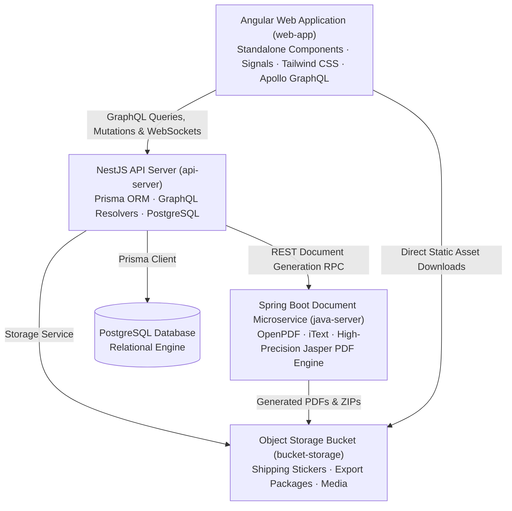
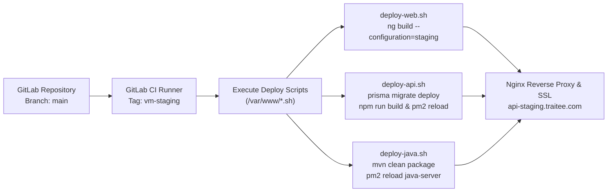
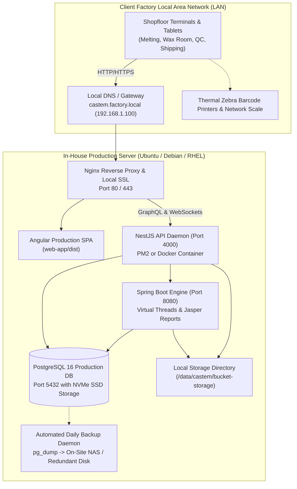

# CASTEM Manufacturing Execution System (MES) & ERP Documentation

Welcome to the official technical and functional documentation for the **CASTEM MES & ERP Platform**.

This documentation repository provides an architectural, functional, and operational breakdown of the core pillars and deployment pipelines that power CASTEM's precision investment casting, machining, inventory, sales, and quality operations.

---

## 🏛️ System Architecture Overview

The system is architected as a modern, distributed manufacturing execution platform:



* **Frontend (`web-app`)**: Angular 19+ using standalone components, Angular Signals for state management, Apollo Angular GraphQL client, and Tailwind CSS.
* **Backend API (`api-server`)**: NestJS enterprise framework with Prisma ORM, code-first GraphQL schemas, PostgreSQL relational engine, and automated GraphQL Code Generator.
* **Document Engine (`java-server`)**: High-performance Java 21 / Spring Boot microservice specialized in rendering multi-page high-resolution PDF shipping documents, commercial invoices, QR-coded travelers, and sticker ZIP archives using Java Virtual Threads.
* **Storage (`bucket-storage`)**: Managed file storage for shipping stickers, exported Excel/PDF packages, and inspection media.

---

## 🚀 Deployment Architectures

CASTEM supports two primary deployment topologies:
1. **Staging Environment**: Automated CI/CD deployment on a cloud Virtual Machine (`vm-staging`).
2. **Production Environment (Client In-House Server)**: On-premise deployment on the client's internal factory server / private LAN for zero-latency shop floor operation and data sovereignty.

---

### 1. Staging Deployment (GitLab CI/CD & Cloud VM)

The staging environment runs on a dedicated cloud Linux VM hosting `api-staging.traitee.com`. Deployment is fully automated through GitLab CI/CD runner pipelines tagged with `vm-staging`.



#### Pipeline Configuration (`.gitlab-ci.yml`)
Each sub-repository includes an automated deployment hook:
* **Frontend** (`web-app/.gitlab-ci.yml`): Triggers `/var/www/deploy-web.sh` upon commits to `main`.
* **Backend API** (`api-server/.gitlab-ci.yml`): Triggers `/var/www/deploy-api.sh` upon commits to `main`.
* **Document Engine** (`java-server/.gitlab-ci.yml`): Triggers `/var/www/deploy-java.sh` upon commits to `main`.

#### Server Deployment Scripts & Responsibilities
1. **Frontend Deployment (`/var/www/deploy-web.sh`)**:
   ```bash
   cd /var/www/web-app
   git pull origin main
   npm ci
   npm run build -- --configuration=staging
   # Compiles to dist/web-app and serves via Nginx static root
   ```
2. **Backend API Deployment (`/var/www/deploy-api.sh`)**:
   ```bash
   cd /var/www/api-server
   git pull origin main
   npm ci
   npx prisma generate
   npx prisma migrate deploy
   npm run build
   pm2 reload api-server --update-env
   ```
3. **Document Engine Deployment (`/var/www/deploy-java.sh`)**:
   ```bash
   cd /var/www/java-server
   git pull origin main
   ./mvnw clean package -DskipTests
   pm2 reload java-server --update-env
   ```

#### Nginx Staging Routing Configuration
* **Port 443 (HTTPS)**: SSL termination via Let's Encrypt Certbot.
* **`https://api-staging.traitee.com/graphql`**: Proxied to NestJS API Server (`http://127.0.0.1:4000/graphql`) with WebSocket upgrade headers (`Upgrade $http_upgrade`, `Connection "upgrade"`).
* **`https://api-staging.traitee.com/api/bucket-storage`**: Static alias to `/var/www/bucket-storage`.
* **Inter-Service Communication**: NestJS communicates with Java Spring Boot over `http://127.0.0.1:8080` authenticated via `INTERNAL_API_SECRET`.

---

### 2. Production Deployment (Client In-House Server)

For the client's manufacturing plant, CASTEM is designed to run on an **on-premise in-house server** connected to the factory's local area network (LAN / Intranet). This guarantees that shop floor barcode scanning, machine booking, and pour logging function with zero latency and remain 100% operational even during external internet outages.



---

#### Deployment Option A: Docker Compose (Recommended)

Docker Compose provides a fully containerized, reproducible deployment isolating all runtimes:

```yaml
# docker-compose.prod.yml
version: "3.8"

services:
  postgres:
    image: postgres:16-alpine
    container_name: castem-postgres
    restart: always
    environment:
      POSTGRES_DB: castem_production
      POSTGRES_USER: ${DB_USER:-castem}
      POSTGRES_PASSWORD: ${DB_PASSWORD}
    volumes:
      - /data/castem/postgres:/var/lib/postgresql/data
    ports:
      - "127.0.0.1:5432:5432"
    healthcheck:
      test: ["CMD-SHELL", "pg_isready -U castem -d castem_production"]
      interval: 10s
      timeout: 5s
      retries: 5

  api-server:
    build:
      context: ./api-server
      dockerfile: Dockerfile
    container_name: castem-api
    restart: always
    depends_on:
      postgres:
        condition: service_healthy
    environment:
      NODE_ENV: production
      PORT: 4000
      DATABASE_URL: "postgres://${DB_USER:-castem}:${DB_PASSWORD}@postgres:5432/castem_production"
      BUCKET: "/data/bucket-storage"
      STORAGE_BASE_URL: "https://${FACTORY_DOMAIN:-castem.factory.local}/api/bucket-storage"
      JWT_SECRET: ${JWT_SECRET}
      INTERNAL_API_SECRET: ${INTERNAL_API_SECRET}
    volumes:
      - /data/castem/bucket-storage:/data/bucket-storage
    ports:
      - "127.0.0.1:4000:4000"

  java-server:
    build:
      context: ./java-server
      dockerfile: Dockerfile
    container_name: castem-java
    restart: always
    depends_on:
      postgres:
        condition: service_healthy
    environment:
      SERVER_PORT: 8080
      DATABASE_URL: "jdbc:postgresql://postgres:5432/castem_production"
      DB_USERNAME: ${DB_USER:-castem}
      DB_PASSWORD: ${DB_PASSWORD}
      INTERNAL_API_SECRET: ${INTERNAL_API_SECRET}
      STORAGE_BUCKET_ROOT: "/data/bucket-storage"
    volumes:
      - /data/castem/bucket-storage:/data/bucket-storage
    ports:
      - "127.0.0.1:8080:8080"

  nginx:
    image: nginx:alpine
    container_name: castem-nginx
    restart: always
    depends_on:
      - api-server
      - java-server
    ports:
      - "80:80"
      - "443:443"
    volumes:
      - ./web-app/dist/web-app/browser:/usr/share/nginx/html:ro
      - /data/castem/bucket-storage:/data/bucket-storage:ro
      - ./nginx/prod.conf:/etc/nginx/conf.d/default.conf:ro
      - ./nginx/ssl:/etc/nginx/ssl:ro
```

---

#### Deployment Option B: Bare-Metal Linux Service (`systemd` + `PM2`)

For direct bare-metal hardware execution on an enterprise Ubuntu Server (22.04 / 24.04 LTS):

1. **System Prerequisites**:
   * **Node.js**: v20.x or v22.x LTS (`nvm` or NodeSource).
   * **Java**: OpenJDK 21 LTS (`sudo apt install openjdk-21-jdk`).
   * **PostgreSQL**: PostgreSQL 16+ (`sudo apt install postgresql postgresql-contrib`).
   * **Process Manager**: PM2 installed globally (`npm install -g pm2`).
   * **Web Server**: Nginx (`sudo apt install nginx`).

2. **Step-by-Step Production Build Sequence**:
   ```bash
   # 1. Build Document Engine
   cd /opt/castem/java-server
   ./mvnw clean package -DskipTests
   
   # 2. Build Backend API Server & Run DB Migrations
   cd /opt/castem/api-server
   npm ci
   npx prisma generate
   npx prisma migrate deploy
   npm run build
   
   # 3. Build Frontend Single Page Application
   cd /opt/castem/web-app
   npm ci
   npm run build -- --configuration=production
   ```

3. **PM2 Ecosystem Configuration (`/opt/castem/ecosystem.config.js`)**:
   ```javascript
   module.exports = {
     apps: [
       {
         name: "castem-api",
         cwd: "/opt/castem/api-server",
         script: "dist/main.js",
         instances: "max",
         exec_mode: "cluster",
         env: {
           NODE_ENV: "production",
           PORT: 4000,
         },
       },
       {
         name: "castem-java",
         cwd: "/opt/castem/java-server",
         script: "java",
         args: "-jar target/java-server-0.0.1-SNAPSHOT.jar",
         instances: 1,
         exec_mode: "fork",
         env: {
           JAVA_SERVER_PORT: 8080,
         },
       },
     ],
   };
   ```

4. **Nginx In-House Production Configuration (`/etc/nginx/sites-available/castem`)**:
   ```nginx
   server {
       listen 80;
       server_name castem.factory.local 192.168.1.100;
       return 301 https://$host$request_uri;
   }

   server {
       listen 443 ssl http2;
       server_name castem.factory.local 192.168.1.100;

       ssl_certificate /etc/nginx/ssl/castem-factory.crt;
       ssl_certificate_key /etc/nginx/ssl/castem-factory.key;

       # Frontend SPA
       root /opt/castem/web-app/dist/web-app/browser;
       index index.html;

       location / {
           try_files $uri $uri/ /index.html;
       }

       # Backend GraphQL & WebSocket Endpoint
       location /graphql {
           proxy_pass http://127.0.0.1:4000/graphql;
           proxy_http_version 1.1;
           proxy_set_header Upgrade $http_upgrade;
           proxy_set_header Connection "upgrade";
           proxy_set_header Host $host;
           proxy_set_header X-Real-IP $remote_addr;
           proxy_set_header X-Forwarded-For $proxy_add_x_forwarded_for;
           proxy_set_header X-Forwarded-Proto $scheme;
           proxy_read_timeout 300s;
           proxy_send_timeout 300s;
       }

       # Static Storage Bucket for PDF Stickers and Exports
       location /api/bucket-storage {
           alias /data/castem/bucket-storage;
           autoindex off;
           expires 7d;
           add_header Cache-Control "public, no-transform";
       }
   }
   ```

---

#### 3. Enterprise Production Operational Requirements

* **Automated Daily Database Backups**:
  Set up an automated `crontab` task to dump the database nightly to an on-site NAS or dedicated drive:
  ```bash
  # /etc/cron.daily/castem-db-backup
  #!/bin/bash
  BACKUP_DIR="/data/backups/postgres"
  mkdir -p $BACKUP_DIR
  pg_dump -U postgres -d castem_production -F c -b -v -f "$BACKUP_DIR/castem-$(date +\%Y\%m\%d).dump"
  # Retain last 30 days of backups
  find $BACKUP_DIR -type f -name "castem-*.dump" -mtime +30 -delete
  ```
* **Storage Directory Permissions**:
  Ensure `/data/castem/bucket-storage` is owned by the deployment user with `775` permissions to allow both NestJS and Java microservices to generate PDF packages and stickers seamlessly.
* **Thermal Barcode Printing Integration**:
  The in-house server connects directly over the local network to thermal barcode printers (Zebra ZT411 / SATO) for instant palette and carton traveler tag printing.

---

## 📚 Six Main Functional Pillars

Explore the dedicated documentation directories below:

```
castem-docs/
├── README.md                                  # This master navigation index
└── docs/
    ├── master-data/                           # Pillar 1: Enterprise Master Data
    │   ├── README.md
    │   ├── user-section-position-holiday.md
    │   ├── supplier-customer.md
    │   ├── item-itemtype-mould-process.md
    │   ├── material-rawmaterial-group-rotation-melting.md
    │   ├── machine-machinetype-tool.md
    │   └── shipmenttype-boxtype-pallettype-areatype-locationtype.md
    │
    ├── inventory/                             # Pillar 2: Inventory Management
    │   ├── README.md
    │   ├── material-inventory-issuance-history.md
    │   ├── work-in-progress.md
    │   ├── finished-goods-allocation-transaction-movement-stockin.md
    │   └── inventory-count.md
    │
    ├── sales-order/                           # Pillar 3: Sales Order & Shipping
    │   ├── README.md
    │   ├── sales-order.md
    │   └── shipping-pallet-assignment.md
    │
    ├── production-planning/                   # Pillar 4: Production Planning
    │   ├── README.md
    │   ├── production-planning.md
    │   ├── casting-plan-scheduler.md
    │   └── production-plan-scheduler.md
    │
    ├── production-process/                    # Pillar 5: Production Execution & Monitoring
    │   ├── README.md
    │   ├── production-control-boxing-booking-assigning-box.md
    │   └── load-capacity-defective-summary-dtr-monitoring.md
    │
    └── purchase/                              # Pillar 6: Purchasing (Roadmap)
        └── README.md
```

---

### Quick Directory Links

1. [**Master Data**](./docs/master-data/README.md)
   - Foundation for Users, Sections, Positions, Holidays, Partners, Products, Metallurgy, Equipment, and Logistics configurations.
2. [**Inventory**](./docs/inventory/README.md)
   - Full lifecycle inventory control: Raw Materials, Issuance, WIP tracking, Finished Goods, Stock-In, and Movements.
3. [**Sales Order & Shipping**](./docs/sales-order/README.md)
   - Customer PO processing, Order Fulfillment, Pallet Allocation, Box Packaging, Shipping Stickers, and Document Exports (PDF/Excel).
4. [**Production Planning**](./docs/production-planning/README.md)
   - Master Production Schedule, Casting Plan Furnace Scheduler, and Shopfloor Timeline Schedulers.
5. [**Production Process**](./docs/production-process/README.md)
   - Production Control, Process Booking, Boxing, Box Assignment, Machine Load Capacity, Defective Summaries, and DTR Inquiries.
6. [**Purchase**](./docs/purchase/README.md)
   - Planned procurement module: Requisitions, Purchase Orders, Vendor Quotations, and Receiving.
