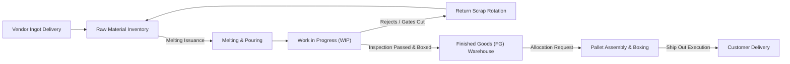

# Pillar 2: Inventory Management

The Inventory Management module maintains real-time physical and financial control of all inventory assets across their entire transformation lifecycle: from raw ingots and return scrap, through intermediate casting processes (WIP), to boxed finished goods awaiting global export.

---

## 📂 Inventory Domains & Documentation

| Domain | Description | Detailed Documentation |
| :--- | :--- | :--- |
| **Material Inventory & Issuance** | Stock levels of virgin ingots, return scrap, melting issuance, and historical movements. | [01. Material Inventory & Issuance](./material-inventory-issuance-history.md) |
| **Work In Progress (WIP)** | In-process tracking by production batch, process routing station, and heat charge lot. | [02. Work In Progress](./work-in-progress.md) |
| **Finished Goods (FG)** | Completed casting lots, customer allocation requests, inter-warehouse movements, manual stock-ins. | [03. Finished Goods](./finished-goods-allocation-transaction-movement-stockin.md) |
| **Inventory Count** | Periodic physical stocktaking and reconciliation for Raw Materials, WIP, and FG. *(Planned)* | [04. Inventory Count (Roadmap)](./inventory-count.md) |

---

## 🔄 Inventory Lifecycle Flow

---

## ⚡ Core Rules & Controls

1. **Lot Traceability**: Every gram of material and finished item carries end-to-end heat charge numbers, casting lot numbers, and manufacturing dates.
2. **Universal Search Filters**: Searchable dropdowns for Box, Area, Location, Material, and Item Code enable rapid stock lookups and movement operations.
3. **Dual Weight Verification**: Physical container weights (Net and Gross) are cross-referenced with standard theoretical item weights (`stdItemWt`) to identify packing count discrepancies.
