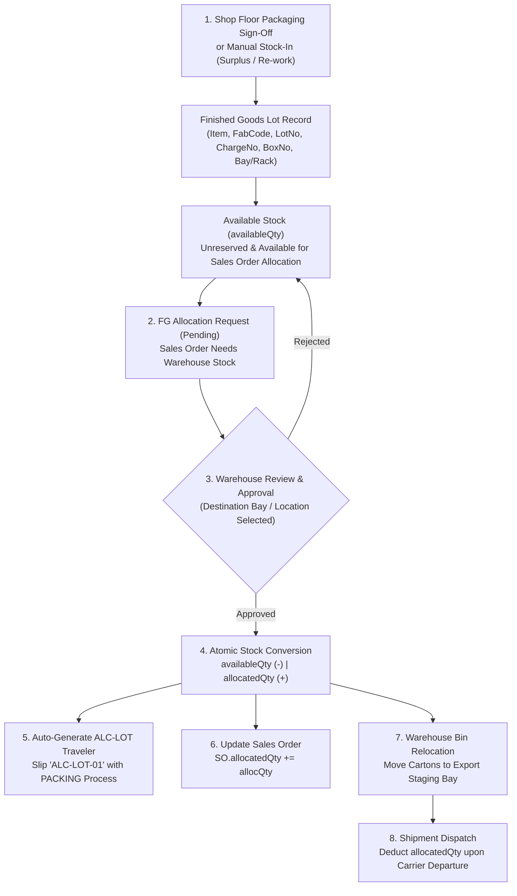
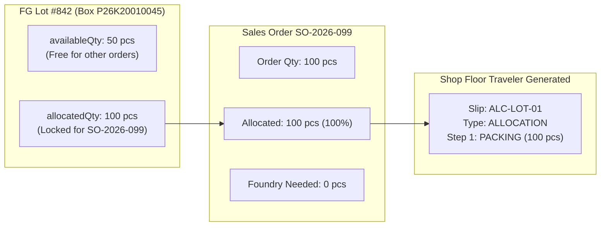

# Inventory: Finished Goods, Allocation, Transactions, Movement & Manual Stock-In

Manages completed, quality-approved casting parts and machined components stored in the Finished Goods Warehouse awaiting packaging, sales order allocation, and export dispatch.

---

## 1. Finished Goods Inventory Architecture & Balance Buckets

In investment casting and precision machining, finished goods are tracked at the individual **carton container** and **warehouse bin coordinate** level.



### Core Balance Buckets (`FinishedGoodsLot`)

| Stock Bucket | Field Name | Description |
| :--- | :--- | :--- |
| **Available Stock** | `availableQty` | Free finished goods ready to satisfy new customer sales orders. |
| **Allocated Stock** | `allocatedQty` | Stock officially reserved for confirmed customer sales orders awaiting dispatch. |
| **Checking Stock** | `checkingQty` | Stock held for quality re-inspection, customer return verification, or visual audit. |
| **Defective Stock** | `defectiveQty` | Scrapped, oxidized, or damaged pieces awaiting disposition or metallurgical remelt. |

* **Composite Unique Key**:
  $$\mathbf{[itemId, \, fabricationId, \, orderNo, \, lotNo, \, chargeNo, \, areaId, \, locationId, \, boxId]}$$
  Ensures precision traceability: no two physical boxes or lot variations can ever collide or blend invisibly in warehouse records.

---

## 2. Allocation Request & Approval Engine

### Rule 1: The Allocation Request Lifecycle
When a sales order can be satisfied partially or entirely from existing warehouse stock rather than running a new foundry pour:
1. **Request Creation (`Pending`)**:
   * Production planners submit a `FinishedGoodsAllocationRequest`.
   * Targets a specific `finishedGoodsLotId`, target `salesOrderId`, and `allocationQty`.
2. **Stock Reservation Gate**:
   * Validates $\text{allocationQty} \le \text{lot.availableQty}$.
3. **Warehouse Review & Approval**:
   * Warehouse supervisor approves the request and assigns the destination staging coordinate (`destinationAreaId`, `destinationLocationId`).

---

### Rule 2: Atomic Approval Execution (SIV-23 Standard)
Upon approval, an atomic transaction executes 4 simultaneous actions:
1. **Lot Balance Conversion**:
   $$\text{availableQty} \longleftarrow \text{availableQty} - \text{allocationQty}$$
   $$\text{allocatedQty} \longleftarrow \text{allocatedQty} + \text{allocationQty}$$
2. **Immutable Transaction Ledger Entry**:
   * Writes to `FinishedGoodsTransaction` with `transactionType = "ALLOCATION"`, `fromStatus = "AVAILABLE"`, `toStatus = "ALLOCATED"`.
3. **Automatic Production Slip Generation (`ALC-LOT-XX`)**:
   * Creates a dedicated zero-foundry-lead-time production slip:
     * `lotNo = "ALC-LOT-01"` (`type = "ALLOCATION"`).
     * `totalQty = allocationQty`.
     * Generates a single **`PACKING`** routing step (`neededQty = allocationQty`) so packaging travelers and export stickers can be printed immediately on the shop floor.
4. **Sales Order Synchronization**:
   $$\text{SalesOrder.allocatedQty} \longleftarrow \text{SalesOrder.allocatedQty} + \text{allocationQty}$$
   $$\text{SalesOrder.productionQty} \longleftarrow \max\bigl(0,\, \text{orderQty} - \text{allocatedQty} - \text{packedQty}\bigr)$$

---

## 3. Warehouse Movement & Manual Stock-In Engine

### Rule 3: Bin-to-Bin Movement (`move` / `batchMove`)
When cartons are moved from long-term storage racks to export staging areas:
* Validates source lot has $\ge \text{quantity}$ in `availableQty` or `allocatedQty`.
* Deducts quantity from source `[areaId, locationId]`.
* Credits quantity to destination `[toAreaId, toLocationId]` (upserting destination `FinishedGoodsLot`).
* Logs an internal movement record in `FinishedGoodsTransaction` (`direction = "INTERNAL"`, `transactionType = "MOVEMENT"`).

---

### Rule 4: Manual Stock-In (`manualIn` / `batchManualIn`)
Enables warehouse supervisors to register existing, converted, or trial inventory into Finished Goods without requiring a full shop-floor booking traveler:
* **Searchable Selectors**: Provides universal fuzzy-search dropdowns for Item, Box Container, Storage Area, and Location.
* **Auto-Resolution of Fabrication**: If an item does not specify a fabrication code, defaults automatically to base code `"000"`.
* **Instant Ledgering**: Creates `FinishedGoodsTransaction` with `transactionType = "MANUAL_IN"` and `direction = "INBOUND"`.

---

## 4. Concrete Examples of Expected Groupings (Inputs vs. Results)

### Example 1: Manual Stock-In of Surplus Machined Castings

Following a machining trial run, 150 pieces of an aerospace bracket are certified by quality control and received into the Finished Goods Warehouse.

#### 1. Input Stock-In Data
* **Item Code**: `10-03913-000` (Inconel 718 Bracket)
* **Fabrication Code**: `000` (Base Casting)
* **Source Production Order**: `SO-2026-TRIAL` | **Lot No**: `LOT-991` | **Charge No**: `440.3-X9-001`
* **Carton Container**: Box `P26K20010045` (`BoxType: STD-CARTON-200`)
* **Quantity**: `150 pcs`
* **Destination Storage**: Area `FG-WH-01` (Finished Goods Bay 1), Location `RACK-B-04`
* **Initial Status**: `AVAILABLE`

#### 2. Execution & Balance Result
1. The inventory engine invokes `manualIn`.
2. Upserts `FinishedGoodsLot` for `[10-03913-000, 000, SO-2026-TRIAL, LOT-991, 440.3-X9-001, Bay 1, Rack B-04, Box 45]`.
3. Balance is credited:
   $$\text{availableQty} \longleftarrow 0 + 150 = \mathbf{150\text{ pcs}}$$
4. Ledger record created in `FinishedGoodsTransaction`:

| Field | Value |
| :--- | :--- |
| **Transaction No** | `TX-FG-MAN-1732098400` |
| **Transaction Type** | `MANUAL_IN` |
| **Direction** | `INBOUND` |
| **Item Code** | `10-03913-000` |
| **Lot & Charge** | Lot `LOT-991` (Heat `440.3-X9-001`) |
| **Quantity** | **+150 pcs** |
| **Balance After** | **150 pcs** |
| **Storage Bin** | `FG-WH-01 / RACK-B-04` |
| **Box Identifier** | `P26K20010045` |
| **Status Result** | `AVAILABLE` |

---

### Example 2: Sales Order Allocation Request & Approval (Generating `ALC-LOT-01`)

A customer places an urgent order for 100 pieces of part `10-03913-000`. The planner discovers that 150 pieces are available in warehouse stock (from Example 1) and fulfills the order without running a new melt.

#### 1. Input Allocation Requisition
* **Target Sales Order**: `SO-2026-099` (`orderQty = 100 pcs`, current `allocatedQty = 0`, `packedQty = 0`)
* **Source Finished Goods Lot**: ID `842` (Current `availableQty = 150 pcs`, `allocatedQty = 0 pcs`)
* **Requested Allocation Qty**: `100 pcs`
* **Staging Destination**: Area `STAGING-BAY-01`, Location `LANE-A-EXPORT`

#### 2. Execution Step-by-Step
1. **Pre-Check**:
   $$\text{lot.availableQty } (150\text{ pcs}) \ge \text{req.allocationQty } (100\text{ pcs}) \implies \mathbf{Approved}$$
2. **Atomic Stock Decrement / Increment**:
   * `FinishedGoodsLot.availableQty`: $150 - 100 = \mathbf{50\text{ pcs}}$ remaining available.
   * `FinishedGoodsLot.allocatedQty`: $0 + 100 = \mathbf{100\text{ pcs}}$ locked for `SO-2026-099`.
3. **Production Slip Generated**:
   * Creates `ProductionSlip`:
     * `orderNo = "SO-2026-099"`
     * `lotNo = "ALC-LOT-01"`
     * `type = "ALLOCATION"`
     * `totalQty = 100 pcs`
     * `status = "Pending"`
   * Creates `ProductionProcess`:
     * `stepNo = 1`
     * `processName = "PACKING & EXPORT BOXING"`
     * `neededQty = 100 pcs`
4. **Sales Order Synchronization**:
   * `SalesOrder.allocatedQty` updated from $0 \rightarrow \mathbf{100\text{ pcs}}$.
   * `SalesOrder.productionQty` updated from $100 \rightarrow \mathbf{0\text{ pcs}}$ (No foundry casting required!).

#### 3. Resulting Output State



---

### Example 3: Warehouse Bin-to-Bin Movement (`Movement`)

Warehouse staff relocate the 100 allocated pieces for Order `SO-2026-099` from the general storage rack to the export staging bay.

#### 1. Input Movement Data
* **Finished Goods Lot**: ID `842` (Box `P26K20010045`)
* **Source Location**: Area `FG-WH-01`, Location `RACK-B-04`
* **Destination Location**: Area `EXP-STAGE`, Location `BAY-01`
* **Quantity to Relocate**: `100 pcs` (`status = ALLOCATED`)

#### 2. System Execution
1. The engine checks that source lot has at least 100 pcs in `allocatedQty` at `RACK-B-04`.
2. Decrements source lot `allocatedQty` by 100 pcs.
3. Increments destination lot `allocatedQty` at `EXP-STAGE / BAY-01` by 100 pcs.
4. Generates an internal transaction record in `FinishedGoodsTransaction`:

| Field | Value | Explanation |
| :--- | :--- | :--- |
| **Transaction No** | `TX-FG-MOV-1732098800` | Automated movement identifier. |
| **Transaction Type** | `MOVEMENT` | Physical transfer between warehouse coordinates. |
| **Direction** | `INTERNAL` | Internal warehouse transfer. |
| **Quantity** | **100 pcs** | Transferred cartons. |
| **From Bin** | `FG-WH-01 / RACK-B-04` | Source long-term rack. |
| **To Bin** | `EXP-STAGE / BAY-01` | Destination export marshaling lane. |
| **Status Preserved** | `ALLOCATED` | Stock remains reserved for Order `SO-2026-099`. |

---

### Example 4: Quality Status Change (Quarantine to Checking / Defective)

During pre-shipment container loading, warehouse QA discovers water damage on 10 pieces stored in a carton.

#### 1. Input Status Change
* **Finished Goods Lot**: ID `842` (Current: 50 pcs `AVAILABLE`)
* **Quantity to Quarantine**: `10 pcs`
* **From Status**: `AVAILABLE`
* **To Status**: `CHECKING`
* **Reason**: `Visual audit: Carton carton corner moisture detected.`

#### 2. System Execution & Balance Result
1. The inventory engine invokes `changeStatus`.
2. Validates `availableQty >= 10 pcs` (Pass: 50 pcs on-hand).
3. Updates lot balances:
   $$\text{availableQty} \longleftarrow 50 - 10 = \mathbf{40\text{ pcs}}$$
   $$\text{checkingQty} \longleftarrow 0 + 10 = \mathbf{10\text{ pcs}}$$
4. Transaction logged in `FinishedGoodsTransaction`:
   * `transactionType = "STATUS_CHANGE"`
   * `fromStatus = "AVAILABLE"` $\rightarrow$ `toStatus = "CHECKING"`
   * `quantity = 10 pcs`
   * `balanceAfter = 40 pcs (available)`
   * `reason = "Visual audit: Carton corner moisture detected."`

The 10 pieces are now blocked from sales order allocation until cleared by Quality Engineering.

---

### Example 5: Insufficient Available Quantity Allocation Rejection

What happens when an allocation request asks for more stock than the warehouse possesses?

#### 1. Input Requisition
* **Order Demand**: 300 pieces of part `10-03913-000`.
* **Target FG Lot**: ID `842` (Current `availableQty`: **40 pcs**).
* **Requested Allocation**: `300 pcs`.

#### 2. Result
* The allocation approval engine pre-validates stock:
  $$\text{lot.availableQty } (40\text{ pcs}) < \text{req.allocationQty } (300\text{ pcs}) \implies \mathbf{Failed}$$
* The transaction is rejected and rolls back:
  ```json
  {
    "error": "INSUFFICIENT_STOCK",
    "message": "Insufficient available lot stock (40) for requested allocation (300)."
  }
  ```
* **Resolution**: The planner allocates the 40 pieces available from stock, and schedules a production plan for the remaining **260 pieces** to be cast by the foundry.

---

## 5. Summary Reference Cheat Sheet

| Operation / Action | Stock Buckets Affected | Sales Order Impact | Generated Shop Floor Artifact |
| :--- | :--- | :--- | :--- |
| **Manual Stock-In** | `availableQty (+)` | None | `FinishedGoodsTransaction (MANUAL_IN)` |
| **FG Allocation Approval** | `available (-)`, `allocated (+)` | `SO.allocatedQty (+)` | Production Slip `ALC-LOT-01` (Packing Step) |
| **Allocation Cancellation** | `allocated (-)`, `available (+)` | `SO.allocatedQty (-)` | Cancels `ALC-LOT-01` slip |
| **Warehouse Movement** | Bin A `(-)` $\rightarrow$ Bin B `(+)` | Preserves order link | `FinishedGoodsTransaction (MOVEMENT)` |
| **Quality Status Change** | `available (-)` $\rightarrow$ `checking (+)` | Excludes from allocation | Quarantine Hold Traveler |
| **Shipment Dispatch** | `allocatedQty (-)` | `SO.shippingStatus = SHIPPED` | `FinishedGoodsTransaction (SHIP_OUT)` |
