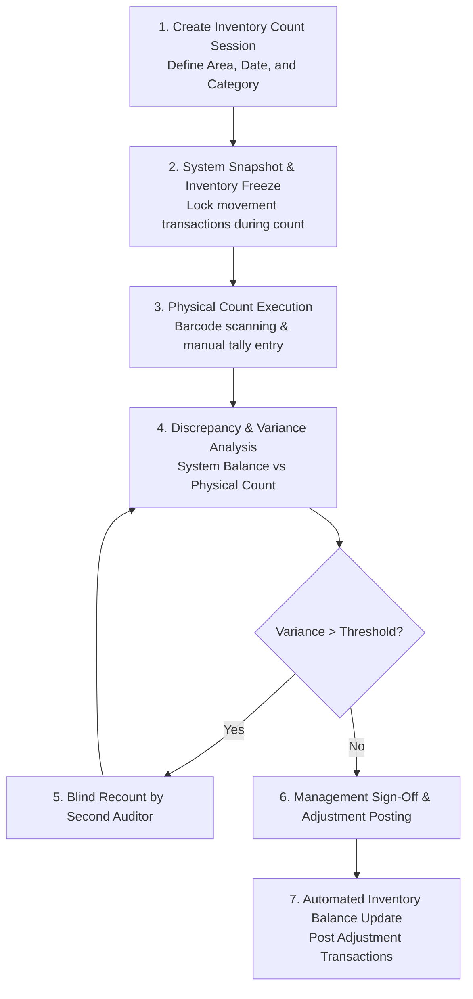

# Inventory: Inventory Count (Physical Count - Planned Module)

> [!NOTE]
> **Status: Planned / Roadmap (Not Yet Implemented)**
> This module describes the planned design specifications and architectural requirements for periodic physical stocktaking and variance reconciliation across CASTEM facilities.

---

## 1. Objectives

1. **Cycle Counting & Wall-to-Wall Physical Count**:
   * Enable scheduled cycle counts (e.g., weekly high-value alloys, monthly WIP, annual wall-to-wall counts).
2. **Multi-Category Counting Scope**:
   * **Raw Materials**: Weight verification of virgin ingots, scrap bins, and chemical additives.
   * **Work in Progress (WIP)**: Count of active travelers, batch pieces, and heat charges on the shop floor.
   * **Finished Goods (FG)**: Barcode/QR scanning of boxed stock in warehouse storage bins.

---

## 2. Planned Operational Workflow

---

## 3. Data Entities to be Implemented

* `InventoryCountSession`: Header record capturing date, category, status (`DRAFT`, `IN_PROGRESS`, `REVIEW`, `APPROVED`, `POSTED`).
* `InventoryCountItem`: Line item recording system theoretical balance, physical count, counted by, timestamp, and variance.
* `InventoryAdjustmentLog`: Financial and stock reconciliation log capturing authorized adjustment causes.
