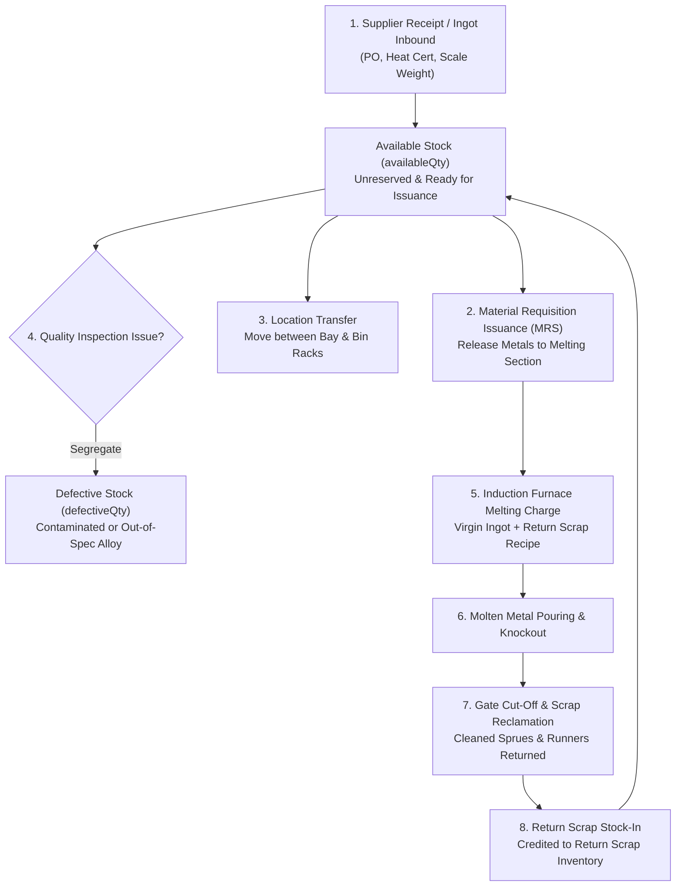

# Inventory: Material Inventory, Issuance & History

Maintains precise, auditable tracking of raw alloy metals—including certified virgin ingots, internal return scrap (recycled sprues and runners), external purchased scrap, and master alloying additions—from receiving dock to furnace pour.

---

## 1. Material Inventory Architecture & Balance Buckets

In investment casting, metallurgy is strictly controlled by weight (kg). Every raw material stock balance is tracked within a specific warehouse bay and physical bin coordinate.



### Core Balance Buckets (`MaterialInventoryLot`)

| Stock Bucket | Field Name | Description |
| :--- | :--- | :--- |
| **Available Stock** | `availableQty` | Free physical inventory ready for furnace requisition and issuance. |
| **Allocated Stock** | `allocatedQty` | Stock reserved for planned casting heats confirmed in the Casting Plan Scheduler. |
| **Pending Stock** | `pendingQty` | Incoming supplier deliveries awaiting QA spectrometer analysis or weighing. |
| **Defective Stock** | `defectiveQty` | Segregated material failing spectrometer chemistry or suspected of cross-contamination. |

* **Unique Lot Key**: `[materialId, lotNo, receivingReportNo, areaId, locationId]` ensures complete traceability back to the supplier delivery ticket or internal scrap rotation batch.

---

## 2. Material Issuance Engine & Business Rules

### Rule 1: Material Requisition Slip (`mrsNo`)
Whenever the foundry melting section prepares to charge an induction furnace, an official **Material Requisition Slip** (`MaterialIssuance`) is submitted:
* Format: `MRS-YYYYMMDD-XXXX` (e.g., `MRS-20261120-0012`).
* Specifies: Requesting `sectionId` (e.g., Foundry Melting Section), Requestor User ID, Target Date, and Itemized Lots.

---

### Rule 2: Strict Pre-Allocation Stock Validation
Before an issuance transaction commits to the ledger, the engine executes an atomic stock verification across all requested lines:

$$\forall \text{ item } i \in \text{MRS: } \quad \text{item.quantity}_i \le \text{lot.availableQty}_i$$

> [!CAUTION]
> If any single lot in the requisition has $\text{item.quantity} > \text{availableQty}$, the entire transaction aborts with an `INSUFFICIENT_STOCK` error:
> `Item #1 (SCM440 Virgin Ingot, Lot: ING-2026-901): Insufficient Available quantity. Available: 45.00 KG, Requested: 100.00 KG.`

---

### Rule 3: Deterministic Lock Ordering & Atomic Ledger Entry
To eliminate database deadlocks under high-volume plant floor conditions:
1. Requisition line items are sorted deterministically by `materialInventoryLotId` ascending.
2. In an atomic database transaction:
   * `MaterialInventoryLot.availableQty` is decremented by the requested kilograms:
     $$\text{availableQty}_{\text{new}} = \text{availableQty}_{\text{old}} - \text{item.quantity}$$
   * A permanent record is created in `MaterialIssuanceItem`.
   * An immutable ledger entry is written to `MaterialInventoryTransaction`:
     * `transactionType = "ISSUANCE"`
     * `direction = "OUTBOUND"`
     * `referenceNo = mrsNo`
     * `balanceAfter = availableQty_new`

---

### Rule 4: Scrap Rotation & Reclamation (`RawMaterialRotation`)
When ceramic shells are knocked out and gates/runners are cut off at Step 6 of production:
* The internal scrap pieces are weighed.
* Metallurgists verify alloy purity against the lot traveler's `chargeNo`.
* Scrap is credited back to `MaterialInventoryLot` under the designated internal return scrap lot number (e.g., `RET-SCM440-26K`).

---

## 3. Concrete Examples of Expected Groupings (Inputs vs. Results)

### Example 1: Material Receipt (Supplier Ingot Delivery Stock-In)

The warehouse receives a pallet shipment of certified virgin stainless steel ingots from an approved metal supplier.

#### 1. Input Receiving Data
* **Supplier**: Daido Steel Co. (`supplierId = 14`)
* **Material**: `SCS13` (Cast equivalent of SUS304 Stainless Steel)
* **Supplier Ingot Lot No**: `LOT-DS-9941`
* **Receiving Report No (`RR`)**: `RR-2026-11-042`
* **Purchase Order No**: `PO-2026-8801`
* **Scale Weight**: `500.00 kg`
* **Destination Storage**: Area `RM-WH-01` (Raw Material Bay 1), Location `RACK-A-03`
* **Spectrometer QC Sampling**: Passed (`qcSampling = "PASSED"`, Mill Sheet attached).

#### 2. Execution & Balance Result
1. The inventory engine invokes `manualIn` with transaction type `RECEIPT`.
2. Locates or creates `MaterialInventoryLot` for `[SCS13, LOT-DS-9941, RR-2026-11-042, Area 1, Loc 3]`.
3. Balance is credited:
   $$\text{availableQty} \longleftarrow 0.00 + 500.00 = \mathbf{500.00\text{ kg}}$$
4. Ledger record generated:

| Field | Value |
| :--- | :--- |
| **Transaction No** | `TX-MAT-REC-1732095000` |
| **Transaction Type** | `RECEIPT` |
| **Direction** | `INBOUND` |
| **Material** | `SCS13` (Stainless Steel) |
| **Lot Number** | `LOT-DS-9941` |
| **Quantity** | **+500.00 kg** |
| **Balance After** | **500.00 kg** |
| **Storage Location** | `RM-WH-01 / RACK-A-03` |
| **Reference No** | `RR-2026-11-042 (PO: PO-2026-8801)` |

---

### Example 2: Material Issuance for Induction Furnace Heat

The Melting Section prepares to melt a **165 kg charge** of `SCM440` alloy in Furnace #3 based on confirmed Casting Plan `440.3-X9-001`. The metallurgy recipe mandates a **50% Virgin Ingot + 50% Return Scrap** ratio.

#### 1. Input Requisition Specifications
* **MRS Number**: `MRS-20261120-004`
* **Requesting Section**: Foundry Melting Section (`sectionId = 3`)
* **Total Charge Weight**: `165.00 kg`
* **Line Items**:
  * **Line 1 (Virgin Ingot)**:
    * Material: `SCM440` Virgin Ingot
    * Lot: `ING-SCM-881` (Storage: `BAY-1 / BIN-02`)
    * Current Available Stock: `250.00 kg`
    * Requisition Qty: **82.50 kg**
  * **Line 2 (Internal Return Scrap)**:
    * Material: `SCM440` Clean Return Runners
    * Lot: `RET-SCM-26K` (Storage: `SCRAP-BAY / BIN-01`)
    * Current Available Stock: `120.00 kg`
    * Requisition Qty: **82.50 kg**

#### 2. Calculation & Stock Update Walkthrough
1. **Pre-Check**:
   * Line 1: $82.50\text{ kg} \le 250.00\text{ kg}$ (Pass).
   * Line 2: $82.50\text{ kg} \le 120.00\text{ kg}$ (Pass).
2. **Stock Decrements**:
   * Virgin Lot `ING-SCM-881`: $250.00 - 82.50 = \mathbf{167.50\text{ kg}}$ remaining.
   * Return Scrap Lot `RET-SCM-26K`: $120.00 - 82.50 = \mathbf{37.50\text{ kg}}$ remaining.
3. **Ledger Entries Created**:

| Tx No | Type | Direction | Material & Lot | Issued Qty | Balance After | Charge Heat Link |
| :---: | :---: | :---: | :--- | :---: | :---: | :--- |
| `TX-MAT-ISS-01` | `ISSUANCE` | `OUTBOUND` | `SCM440` (Virgin `ING-SCM-881`) | **-82.50 kg** | 167.50 kg | Linked to Heat `440.3-X9-001` |
| `TX-MAT-ISS-02` | `ISSUANCE` | `OUTBOUND` | `SCM440` (Scrap `RET-SCM-26K`) | **-82.50 kg** | 37.50 kg | Linked to Heat `440.3-X9-001` |

> [!TIP]
> The physical metal is loaded into charging buckets labeled `440.3-X9-001`. Melt operators verify the scale weight against the printed MRS slip before dropping charges into the induction coil.

---

### Example 3: Returning Recycled Scrap from Gate Cut-Off Station

Following the knockout and abrasive cut-off of the trees poured in Heat `440.3-X9-001`, the remaining gating trees (sprues, runners, pouring cups) are returned to the raw material warehouse.

#### 1. Input Reclamation Data
* **Source Production Process**: Step 6 (`Shell Knockout & Cut-off`)
* **Parent Heat Charge No**: `440.3-X9-001`
* **Alloy Grade**: `SCM440`
* **Clean Cut-Off Scrap Weight**: `94.20 kg` (Net weight on floor scale)
* **Destination Storage**: Area `SCRAP-BAY`, Location `BIN-01`
* **Scrap Target Lot**: `RET-SCM-26K` (Active monthly rotation lot)

#### 2. Stock Update & Ledger Entry
1. The inventory engine invokes `manualIn` with transaction type `RETURN`.
2. Locates lot `RET-SCM-26K` in `SCRAP-BAY / BIN-01` (Current balance: `37.50 kg`).
3. Balance is credited:
   $$\text{availableQty} \longleftarrow 37.50 + 94.20 = \mathbf{131.70\text{ kg}}$$
4. Ledger record created:

| Field | Value | Explanation |
| :--- | :--- | :--- |
| **Transaction No** | `TX-MAT-RET-1732098000` | Automated return transaction identifier. |
| **Transaction Type** | `RETURN` | Reclamation of internal production gates/runners. |
| **Direction** | `INBOUND` | Physical metal returning to inventory. |
| **Material** | `SCM440 Return Scrap` | Chemical purity verified from parent heat. |
| **Lot Number** | `RET-SCM-26K` | Recycled scrap rotation batch. |
| **Quantity** | **+94.20 kg** | Recovered sprues and runners. |
| **Balance After** | **131.70 kg** | Immediately available for subsequent charge recipes. |
| **Reference No** | `440.3-X9-001` | Direct audit link to the original casting heat. |

---

### Example 4: Inter-Bay Location Transfer (Warehouse Reorganization)

Warehouse staff relocate an ingot pallet from the receiving buffer to an upper pallet rack to optimize floor traffic.

#### 1. Input Transfer Specifications
* **Material**: `AC4C` (Aluminum Casting Alloy Ingot)
* **Lot Number**: `LOT-AL-502`
* **Source Location**: Area `RM-RECV-BAY`, Location `FLOOR-STAGE-01`
* **Destination Location**: Area `RM-RACK-02`, Location `LEVEL-2-SLOT-04`
* **Quantity to Move**: `300.00 kg` (Full pallet)

#### 2. System Execution
1. The engine checks that source lot has at least 300.00 kg in `availableQty` at `FLOOR-STAGE-01`.
2. Deducts 300.00 kg from source lot balance.
3. Adds 300.00 kg to destination lot at `LEVEL-2-SLOT-04` (upserting destination lot if it doesn't already exist).
4. Records dual-tracking internal movement in `MaterialInventoryTransaction`:
   * `transactionType = "TRANSFER"`
   * `direction = "INTERNAL"`
   * `fromArea = "RM-RECV-BAY"` $\rightarrow$ `toArea = "RM-RACK-02"`
   * `fromLocation = "FLOOR-STAGE-01"` $\rightarrow$ `toLocation = "LEVEL-2-SLOT-04"`
   * `quantity = 300.00 kg`

---

### Example 5: Insufficient Stock Rejection on Issuance Request

What happens when an MRS request exceeds on-hand warehouse inventory?

#### 1. Input
* Requisition: 150.00 kg of pure electrolytic Nickel (`Ni-CATHODE`) for chemical ladle trimming.
* Lot `NI-LOT-01` current `availableQty`: **42.00 kg**.

#### 2. Result
* The atomic pre-validation check halts execution before any database writes occur.
* The system throws an error:
  ```json
  {
    "code": "INSUFFICIENT_STOCK",
    "message": "Item #1 (Electrolytic Nickel, Lot: NI-LOT-01): Insufficient Available quantity. Available: 42.00 KG, Requested: 150.00 KG."
  }
  ```
* No ledger entries are written; balances remain intact at 42.00 kg.
* Planners are notified to initiate an emergency supplier purchase order.

---

## 4. Summary Reference Cheat Sheet

| Transaction Type | Direction | Affected Balance | Triggering Business Event |
| :--- | :---: | :---: | :--- |
| **`RECEIPT`** | `INBOUND` | `availableQty (+)` | Receiving raw ingots against supplier purchase orders and mill sheets. |
| **`ISSUANCE`** | `OUTBOUND` | `availableQty (-)` | Releasing metal alloys against an approved Material Requisition Slip (`MRS`). |
| **`RETURN`** | `INBOUND` | `availableQty (+)` | Reclaiming cut-off sprues, runners, and gating systems after pouring. |
| **`TRANSFER`** | `INTERNAL` | Net Zero | Moving raw metals between bays, racks, or floor staging bins. |
| **`STATUS_CHANGE`**| `INTERNAL` | `available (-)` / `defective (+)` | Quarantining off-chemistry or contaminated metal batches. |
| **`ADJUSTMENT`** | `IN / OUT` | Scale delta | Physical cycle count adjustments or weigh-scale recalibrations. |
