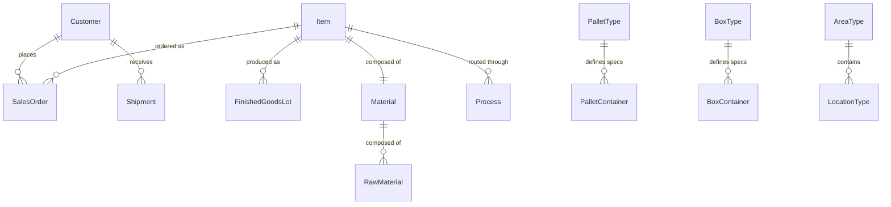

# Pillar 1: Master Data Management

Master Data represents the single source of truth across CASTEM ERP & MES. Every transaction, order, schedule, and movement depends on the entities defined here.

---

## 📂 Master Data Breakdowns

The master data module is divided into six logical domains:

| Domain | Scope & Entities | Detailed Documentation |
| :--- | :--- | :--- |
| **Organization & HR** | Users, Permissions, Sections (Departments), Job Positions, Factory Working Days & Holiday Calendars | [01. Organization & HR](./user-section-position-holiday.md) |
| **Business Partners** | Suppliers (Vendors, Raw Material Sources) and Customers (Currencies, Shipping Addresses, Contacts) | [02. Business Partners](./supplier-customer.md) |
| **Product Definition** | Finished Goods & Component Items, Item Types, Moulds, Mould Types, Standard Item Weights, Routing Processes | [03. Product Definition](./item-itemtype-mould-process.md) |
| **Materials & Metallurgy** | Base Materials, Raw Materials, Chemical Groups, Raw Material Rotation Rules, Melting Furnace Recipes | [04. Metallurgy & Materials](./material-rawmaterial-group-rotation-melting.md) |
| **Equipment & Tooling** | Machines (Furnaces, Presses, Cutters, Blasters), Machine Types, Operational Tools & Fixtures | [05. Equipment & Tooling](./machine-machinetype-tool.md) |
| **Logistics & Storage** | Shipment Types (Sea/Air), Box Types, Pallet Types (Tare/Capacity/Price), Warehouse Area Types, Location Types | [06. Logistics & Storage](./shipmenttype-boxtype-pallettype-areatype-locationtype.md) |

---

## 🔄 Entity Relationship Map

---

## ⚡ Design Principles & System Rules

1. **Universal Searchable Dropdowns**: All master entity selection controls throughout forms and dialogs implement fuzzy search for rapid, typo-tolerant data entry.
2. **Soft Deletion (`deletedAt`, `deletedBy`)**: Master records are soft-deleted to ensure historical integrity and audit compliance across accounting and production history.
3. **Audit Trails**: All creations, modifications, and status changes record timestamps and user IDs automatically via Prisma middleware.
