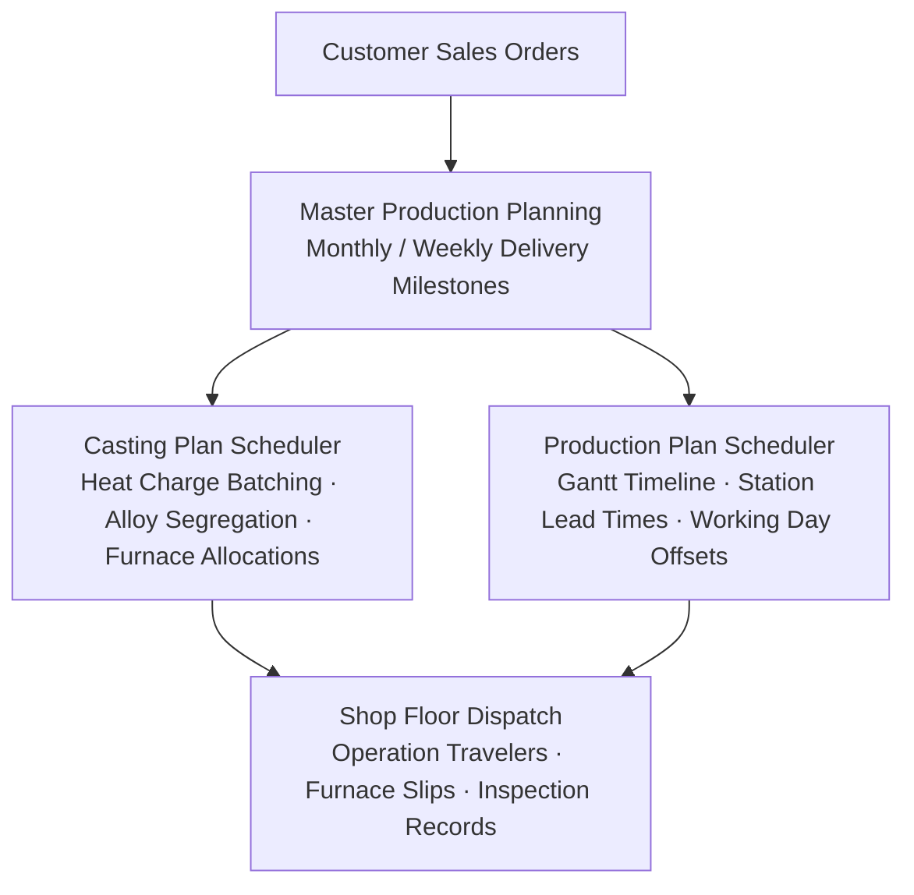

# Pillar 4: Production Planning

The Production Planning module balances customer order commitments against factory capacity, metal melting constraints, mould cavity counts, and routing lead times.

---

## 📂 Production Planning Domains

| Domain | Description | Detailed Documentation |
| :--- | :--- | :--- |
| **Master Production Planning** | High-level monthly and weekly planning, sales order backlog aggregation, and delivery milestone targets. | [01. Production Planning](./production-planning.md) |
| **Casting Plan Scheduler** | Foundry furnace heat scheduling, chemical alloy grouping, virgin/return scrap batching, and induction pour planning. | [02. Casting Plan Scheduler](./casting-plan-scheduler.md) |
| **Production Plan Scheduler** | Process-by-process timeline scheduling from wax pattern injection to final inspection, lead-time offsets, and machine routing. | [03. Production Plan Scheduler](./production-plan-scheduler.md) |

---

## 🔄 Planning Hierarchy & Workflow

---

## ⚡ Core Planning Rules

1. **Working Calendar Awareness**: All lead times and target completion dates automatically account for factory holidays and non-working weekends defined in the `Holiday` master.
2. **Furnace Capacity Optimization**: Melting charges are batched up to the furnace's rated capacity (e.g., 250 kg) while adhering to maximum scrap rotation percentages.
3. **Chemical Alloy Grouping**: Pours are scheduled consecutively by `MaterialGroup` to eliminate refractory contamination.
