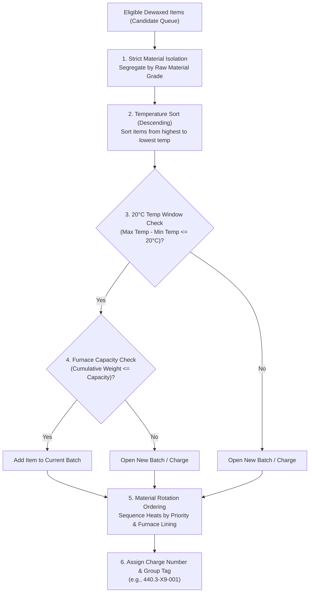

# Production Planning: Casting Plan Scheduler

Manages the scheduling of induction melting heats, furnace batching, alloy segregation, and pouring sequences.

---

## 1. Casting Plan Architecture

In precision investment casting, molten metal is poured into pre-heated ceramic shells in discrete furnace batches called **Heats** or **Charges**.

* **Heat Charge Record (`CastingHeat`)**:
  * `chargeNo`: Unique sequential heat identifier (e.g., `440.3-X9-001`, `S16.8-Y9-002`).
  * `materialId`: Metal alloy grade (e.g., `SCM440`, `SCS13`, `SCS16`, `AC4C`).
  * `furnaceId`: Assigned melting furnace (`Machine`).
  * `scheduledDate` & `shift`: Planned pouring date and shift (Shift 1, Shift 2).
  * `batchWeightKg`: Total charge melt weight in kilograms.
  * `virginIngotKg`: Weight of new supplier ingots.
  * `returnScrapKg`: Weight of internal recycled gates/runners.
  * `treeCount`: Number of ceramic shell trees poured in this heat.
  * `group`: Batch grouping tag matching the `chargeNo`.

---

## 2. Core Batching & Grouping Rules

The **Casting Rule Engine** automatically batches candidate items into furnace charges based on four strict metallurgical and physical constraints:



1. **Strict Raw Material Isolation (Chemical Purity)**:
   * **Rule**: Exactly **1 raw material grade per heat**.
   * Different alloy grades (e.g., `SCM440`, `AC4C`, `S25C`) are **never mixed** in the same furnace charge under any circumstance.
2. **20°C Maximum Temperature Spread**:
   * **Rule**: `Max Pouring Temperature - Min Pouring Temperature <= 20°C`.
   * Even within the same alloy grade, items requiring divergent pouring temperatures cannot be poured together. If the temperature delta exceeds 20°C, the engine automatically splits them into separate charges.
3. **Furnace Capacity Ceiling**:
   * **Rule**: `Total Melt Weight of Batch <= Rated Furnace Capacity`.
   * The cumulative weight of all ceramic trees in a batch cannot exceed the furnace crucible capacity (e.g., 50 kg, 110 kg, 165 kg).
4. **Alloy Rotation & Priority Sequencing**:
   * **Rule**: Batches are ordered on the calendar according to `RawMaterialRotation` priority to minimize furnace lining contamination and refractory wear.
5. **Dewax Milestone Gate**:
   * **Rule**: An item is only eligible for casting scheduling once its upstream ceramic shell **DEWAX** process is 100% completed.

---

## 3. Concrete Examples of Expected Groupings (Inputs vs. Results)

### Example 1: Material Isolation (Never Mix Different Alloys)

#### Input Queue
* Furnace: **Furnace 3** (Capacity: **165 kg**)

| Item Code | Order No | Raw Material | Pouring Temp | Melt Weight |
| :--- | :--- | :--- | :--- | :--- |
| `10-03913-000` | `SO-101` | **SCM440** | 1,660°C | 30.0 kg |
| `10-21740-300` | `SO-102` | **AC4C** (Aluminum) | 730°C | 20.0 kg |
| `10-03913-001` | `SO-103` | **SCM440** | 1,655°C | 25.0 kg |

#### Resulting Grouping
* Total items: 3 | Resulting charges: **2 distinct batches**

| Batch / Group | Charge No | Raw Material | Included Orders | Total Weight | Capacity Check | Notes |
| :--- | :--- | :--- | :--- | :--- | :--- | :--- |
| **Batch 1** | `440.3-X9-001` | **SCM440** | `SO-101`, `SO-103` | **55.0 kg** | 55 kg ≤ 165 kg (33.3% load) | Combined because both are SCM440 and temp delta (5°C) ≤ 20°C |
| **Batch 2** | `AC4.3-X9-002` | **AC4C** | `SO-102` | **20.0 kg** | 20 kg ≤ 165 kg (12.1% load) | Isolated into its own batch due to incompatible material |

---

### Example 2: The 20°C Temperature Window Rule (Splitting Same Material)

#### Input Queue
All items are the same alloy (**SCM440**), but require different pouring temperatures based on wall thickness and casting geometry:
* Furnace: **Furnace 3** (Capacity: **165 kg**)

| Item Code | Order No | Raw Material | Pouring Temp | Melt Weight |
| :--- | :--- | :--- | :--- | :--- |
| `10-101` | `ORD-A` | **SCM440** | **1,680°C** | 25.0 kg |
| `10-102` | `ORD-B` | **SCM440** | **1,665°C** | 30.0 kg |
| `10-103` | `ORD-C` | **SCM440** | **1,650°C** | 20.0 kg |

#### Grouping Logic Step-by-Step
1. Sort descending by temperature: `ORD-A` (1,680°C) ➔ `ORD-B` (1,665°C) ➔ `ORD-C` (1,650°C).
2. Start **Batch 1** with `ORD-A` (1,680°C, 25 kg).
3. Evaluate `ORD-B` (1,665°C, 30 kg):
   * Spread: $1,680°C - 1,665°C = 15°C \le 20°C$ (Pass).
   * Weight: $25 + 30 = 55\text{ kg} \le 165\text{ kg}$ (Pass).
   * ➔ Added to **Batch 1**. (Current batch spread: 1,665°C - 1,680°C).
4. Evaluate `ORD-C` (1,650°C, 20 kg):
   * Spread with batch max: $1,680°C - 1,650°C = 30°C > 20°C$ (**Fails temperature window!**).
   * ➔ `ORD-C` cannot be added to Batch 1. A new batch is initiated.

#### Resulting Grouping
* Total items: 3 | Resulting charges: **2 distinct batches**

| Batch / Group | Charge No | Raw Material | Items Included | Temp Range | Temp Delta | Total Weight |
| :--- | :--- | :--- | :--- | :--- | :--- | :--- |
| **Batch 1** | `440.3-X9-001` | **SCM440** | `ORD-A`, `ORD-B` | 1,665°C – 1,680°C | **15°C** (≤ 20°C) | **55.0 kg** |
| **Batch 2** | `440.3-X9-002` | **SCM440** | `ORD-C` | 1,650°C | **0°C** (Single item) | **20.0 kg** |

---

### Example 3: Furnace Weight Capacity Limit (Splitting Batches)

#### Input Queue
Items share the same material (**SCM440**) and identical pouring temperatures, scheduled on a small **50 kg crucible furnace** (**Furnace 9**):
* Furnace: **Furnace 9** (Capacity: **50 kg**)

| Item Code | Order No | Raw Material | Pouring Temp | Melt Weight | Cumulative Weight |
| :--- | :--- | :--- | :--- | :--- | :--- |
| `10-201` | `PO-01` | **SCM440** | 1,660°C | **22.0 kg** | 22.0 kg (≤ 50 kg) |
| `10-202` | `PO-02` | **SCM440** | 1,655°C | **20.0 kg** | 42.0 kg (≤ 50 kg) |
| `10-203` | `PO-03` | **SCM440** | 1,655°C | **18.0 kg** | 42 + 18 = **60.0 kg** (> 50 kg!) |

#### Grouping Logic Step-by-Step
1. `PO-01` (22 kg) + `PO-02` (20 kg) = **42.0 kg** $\le 50\text{ kg}$ (Fits in Batch 1).
2. Adding `PO-03` (18 kg) would yield **60.0 kg**, exceeding the 50 kg crucible limit.
3. The engine closes Batch 1 at 42.0 kg and rolls `PO-03` into **Batch 2**.

#### Resulting Grouping
* Total items: 3 | Resulting charges: **2 distinct batches**

| Batch / Group | Charge No | Raw Material | Included Orders | Total Weight | Capacity Ceiling | Utilization |
| :--- | :--- | :--- | :--- | :--- | :--- | :--- |
| **Batch 1** | `440.9-X9-001` | **SCM440** | `PO-01`, `PO-02` | **42.0 kg** | 50.0 kg | **84.0%** |
| **Batch 2** | `440.9-X9-002` | **SCM440** | `PO-03` | **18.0 kg** | 50.0 kg | **36.0%** |

---

### Example 4: End-to-End Production Scenario (Multi-Order Batching & Sequencing)

This scenario demonstrates a full production scheduling day on **Furnace 3** (Capacity: **165 kg**), Target Date: **October 20, 2026**.

#### Input Candidate Queue (Raw Candidate Lots)
The following candidate lots have passed the **DEWAX** inspection gate and are ready for casting:

| Lot ID | Item Code | Order No | Raw Material | Temp (°C) | Trees | Pcs/Tree | Total Pcs | Melt Wt (kg) |
| :---: | :--- | :---: | :--- | :---: | :---: | :---: | :---: | :---: |
| #1 | `10-03913-000` | `ORD-501` | **SCM440** | 1,660 | 4 | 6 | 24 | 48.0 |
| #2 | `10-03913-100` | `ORD-502` | **SCM440** | 1,655 | 5 | 8 | 40 | 55.0 |
| #3 | `10-03913-200` | `ORD-503` | **SCM440** | 1,650 | 4 | 4 | 16 | 45.0 |
| #4 | `10-03913-300` | `ORD-504` | **SCM440** | 1,620 | 3 | 5 | 15 | 35.0 |
| #5 | `10-21740-300` | `ORD-601` | **AC4C** | 730 | 2 | 12 | 24 | 18.0 |
| #6 | `10-11825-000` | `ORD-701` | **S25C** | 1,700 | 5 | 4 | 20 | 62.0 |
| #7 | `10-11825-100` | `ORD-702` | **S25C** | 1,695 | 6 | 4 | 24 | 74.0 |

#### Priority & Rotation Master Settings
* **Furnace 3 Starting Material**: `SCM440` (Matches active lining).
* **Material Rotation Priority**:
  1. Priority 1: `SCM440` (Stamping: `440`)
  2. Priority 2: `AC4C` (Stamping: `AC4`)
  3. Priority 3: `S25C` (Stamping: `S25`)

---

#### Step-by-Step Processing by the Rule Engine

1. **Step 1: Material Isolation**:
   * Bucket 1 (`SCM440`): Lots #1, #2, #3, #4 (Total Wt = 183.0 kg).
   * Bucket 2 (`AC4C`): Lot #5 (Total Wt = 18.0 kg).
   * Bucket 3 (`S25C`): Lots #6, #7 (Total Wt = 136.0 kg).
2. **Step 2: Process Bucket 1 (`SCM440`)**:
   * Sort by Temp (descending): #1 (1,660°C), #2 (1,655°C), #3 (1,650°C), #4 (1,620°C).
   * **Batch 1 evaluation**:
     * Add #1 (1,660°C, 48 kg).
     * Add #2 (1,655°C, 55 kg) ➔ Delta = 5°C ≤ 20°C; Wt = 103 kg ≤ 165 kg (Pass).
     * Add #3 (1,650°C, 45 kg) ➔ Delta = $1,660 - 1,650 = 10°C \le 20°C$; Wt = $103 + 45 = 148\text{ kg} \le 165\text{ kg}$ (Pass).
     * Test #4 (1,620°C, 35 kg) ➔ Delta = $1,660 - 1,620 = 40°C > 20°C$ (Fails Temp Window!) AND Wt = $148 + 35 = 183\text{ kg} > 165\text{ kg}$ (Fails Capacity!).
     * ➔ **Batch 1 closed**: Lots #1, #2, #3 (Total Wt = 148.0 kg, Temp: 1,650°C – 1,660°C).
   * **Batch 2 evaluation**:
     * Add #4 (1,620°C, 35 kg).
     * ➔ **Batch 2 closed**: Lot #4 (Total Wt = 35.0 kg, Temp: 1,620°C).
3. **Step 3: Process Bucket 2 (`AC4C`)**:
   * **Batch 3 closed**: Lot #5 (Total Wt = 18.0 kg, Temp: 730°C).
4. **Step 4: Process Bucket 3 (`S25C`)**:
   * **Batch 4 closed**: Lots #6, #7 (Total Wt = 136.0 kg, Temp: 1,695°C – 1,700°C).
5. **Step 5: Sequence Heats by Rotation Priority & Assign Charge Numbers**:
   * Date: `2026-10-20` ➔ Month code: `X` (October), Year index: `9` (`2026 - 2017`).
   * Machine ID: `3` (Furnace 3).

---

#### Final Scheduled Output Result
The 7 input lots are batched and ordered into **4 distinct heats**:

| Heat / Sequence | Charge Number | Group ID | Material | Included Lots | Trees | Total Melt Wt | Furnace Capacity | Temp Range |
| :---: | :--- | :--- | :--- | :---: | :---: | :---: | :---: | :---: |
| **Heat 1** | **`440.3-X9-001`** | `440.3-X9-001` | **SCM440** | Lots #1, #2, #3 | 13 trees | **148.0 kg** | 165 kg (89.7%) | 1,650°C – 1,660°C (Δ10°C) |
| **Heat 2** | **`440.3-X9-002`** | `440.3-X9-002` | **SCM440** | Lot #4 | 3 trees | **35.0 kg** | 165 kg (21.2%) | 1,620°C (Single temp) |
| **Heat 3** | **`AC4.3-X9-003`** | `AC4.3-X9-003` | **AC4C** | Lot #5 | 2 trees | **18.0 kg** | 165 kg (10.9%) | 730°C (Single temp) |
| **Heat 4** | **`S25.3-X9-004`** | `S25.3-X9-004` | **S25C** | Lots #6, #7 | 11 trees | **136.0 kg** | 165 kg (82.4%) | 1,695°C – 1,700°C (Δ5°C) |

> [!TIP]
> **Summary Outcome**:
> * All 7 production lots were scheduled with zero manual calculation errors.
> * No alloys were cross-contaminated.
> * Every batch respected the 20°C pouring window.
> * No charge exceeded the 165 kg furnace capacity.
> * All lots inherit their exact `chargeNo` and `group` identifier, which prints on physical furnace pour slips and downstream operation travelers.

---

### Example 5: Oversized Lot Validation Error

What happens if an individual candidate item's melt weight exceeds the furnace capacity?

#### Input
* Assigned Furnace: **Furnace 1** (Capacity: **50 kg**).
* Candidate Lot: Item `10-HEAVY-01`, melt weight = **75.0 kg**.

#### Result
* The engine **rejects** the scheduling action and throws a hard validation error:
  ```
  Item 10-HEAVY-01 melt weight (75.00 KG) exceeds furnace capacity (50 KG).
  ```
* **Required Resolution**: The planner must assign the job to a larger furnace (e.g., Furnace 3 or 8 with 165 kg capacity) or re-tree the mould pattern to reduce the number of pieces per cluster.

---

## 4. Charge Numbering Format & Breakdown

Every scheduled batch is assigned an official CASTEM charge code:

$$\mathbf{\text{Stamping}} \,.\, \mathbf{\text{MachineID}} - \mathbf{\text{MonthCode}}\mathbf{\text{YearIndex}} - \mathbf{\text{Sequence}}$$

Example: `440.3-X9-001`

```
  440   .   3   -   X   9   -   001
  │         │       │   │        └── Daily sequence (001, 002, 003...)
  │         │       │   └─────────── Year offset: 2026 - 2017 = 9
  │         │       └─────────────── Month code: 1..9, X(Oct), Y(Nov), Z(Dec)
  │         └─────────────────────── Furnace Machine ID (3 = Furnace 3)
  └───────────────────────────────── Material Stamping Code (SCM440 -> 440)
```

### Month Code Lookup
| Month | Jan | Feb | Mar | Apr | May | Jun | Jul | Aug | Sep | Oct | Nov | Dec |
| :---: | :---: | :---: | :---: | :---: | :---: | :---: | :---: | :---: | :---: | :---: | :---: | :---: |
| **Code** | `1` | `2` | `3` | `4` | `5` | `6` | `7` | `8` | `9` | **`X`** | **`Y`** | **`Z`** |

---

## 5. Interactive Scheduler UI & Downstream Integration

* **Visual Calendar & Furnace Grid**: Displays furnace allocations across daily shift timelines.
* **Drag-and-Drop Re-sequencing**: Foundry planners can reorder heats to accommodate emergency plant conditions.
* **Shop Floor Traveler & Pour Slip**:
  Once a casting plan is confirmed, each batch prints an official **Melting Pouring Slip** containing:
  * Charge Number and Group Tag.
  * Required Virgin Ingot kg vs. Return Scrap kg (validated against `RawMaterialRotation`).
  * Target Pouring Temperature and Spectrometer Chemistry tolerances.
