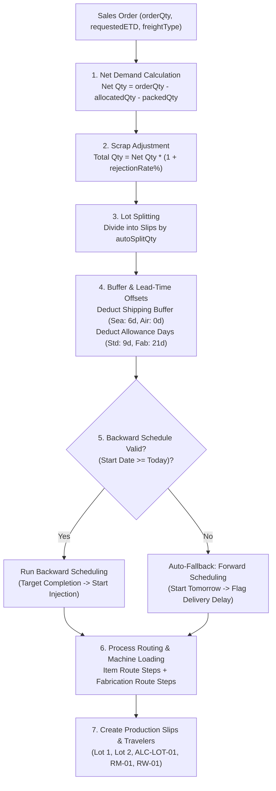
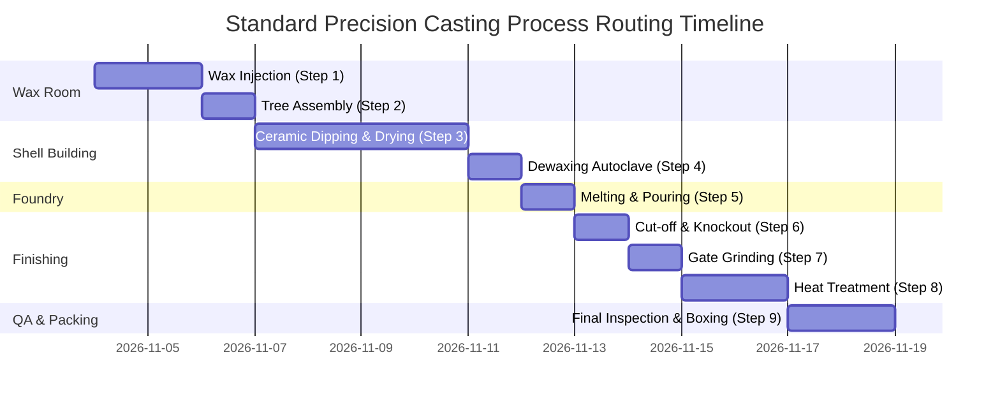

# Production Planning: Production Plan Scheduler

Provides automated process-by-process Gantt timeline scheduling, machine routing, lead-time calculation, working-calendar integration, and lot splitting across all precision casting and fabrication manufacturing stages.

---

## 1. Production Plan Architecture & Core Parameters

The **Production Plan Scheduler** translates Sales Orders into actionable shop-floor production slips and sequential process milestones. It balances customer delivery commitments with factory capacity limits.



### Core Input Parameters

| Parameter | Type | Default | Description |
| :--- | :---: | :---: | :--- |
| `orderQty` | Integer | Required | Total quantity ordered by the customer in the Sales Order. |
| `allocatedQty` | Integer | `0` | Finished Goods (FG) inventory already allocated from stock. |
| `packedQty` | Integer | `0` | Quantity already packed into boxes/pallets awaiting shipment. |
| `rejectionRate` | Decimal | `0.0%` | Item scrap factor (e.g., 5.0%). Compensates for casting yields. |
| `requestedETD` | Date | Required | Customer requested departure / delivery date. |
| `freightType` | String | `SEA` | Logistics mode (`SEA`, `AIR`, `LAND`). Controls shipping buffer. |
| `autoSplitQty` | Integer | `500` | Maximum piece count per production slip (pulled from Item master). |
| `numberOfMoulds` | Integer | `1` | Number of active die mould copies (`mouldCount`) mounted on wax machines. |
| `allowanceDays` | Integer | `9` or `21` | Factory lead-time buffer (default: 9 working days standard, 21 for fabrication). |
| `startInjectionDate` | Date | Optional | Manual start date override. Forces forward scheduling if provided. |
| `schedulePriority` | String | `Normal` | Schedule queue priority (`Normal`, `Urgent`, `Critical`). |
| `scheduleType` | Enum | `standard` | Schedule profile: `standard`, `rework` (`RW-`), `remake` (`RM-`), or `revise`. |

---

## 2. Calculation Engine & Scheduling Rules

### Rule 1: Net Demand & Scrap Compounding
Production demand only accounts for unfulfilled quantities:

$$\text{netRequiredQty} = \max\bigl(0,\, \text{orderQty} - \text{allocatedQty} - \text{packedQty}\bigr)$$

$$\text{totalProductionQty} = \left\lceil \text{netRequiredQty} \times \left(1 + \frac{\text{rejectionRate}}{100}\right) \right\rceil$$

> [!NOTE]
> If $\text{netRequiredQty} = 0$ (the order is completely covered by warehouse stock and packed goods), standard scheduling is locked. A special zero-lead-time **Allocation Slip** (`ALC-LOT-XX`) is generated instead.

---

### Rule 2: Lot Splitting Logic (`autoSplitQty`)
To maintain manageable batch sizes through ceramic dipping and heat treatment furnaces, the total production quantity is automatically split into discrete lot slips:

$$\text{lotCount} = \left\lceil \frac{\text{totalProductionQty}}{\text{autoSplitQty}} \right\rceil$$

* **Lots $1$ through $N-1$**: Fixed at `autoSplitQty`.
* **Lot $N$ (Last Lot)**: Contains the remaining balance:
  $$\text{remainingQty} = \text{totalProductionQty} - \bigl((N - 1) \times \text{autoSplitQty}\bigr)$$

---

### Rule 3: Freight Type & Shipping Buffer Deduction
Customer requested ETD is offset backward to establish the factory gate readiness target (`factoryRequestedEtd` / `targetEndDate`):

$$\text{targetEndDate} = \text{subtractWorkingDays}\bigl(\text{requestedETD},\, \text{shippingBufferDays}\bigr)$$

* **Sea Freight (`SEA`)**: **6 working days** (1 calendar week) buffer required for customs clearing, stuffing, and port transit.
* **Air / Land Freight (`AIR` / `LAND`)**: **0 days** buffer (direct airport/truck dispatch).

---

### Rule 4: Planning Allowance Deduction
To protect against machine breakdowns, refractory relining, and quality rework, the factory imposes an internal allowance buffer:

$$\text{targetProductionEndDate} = \text{subtractWorkingDays}\bigl(\text{targetEndDate},\, \text{allowanceDays}\bigr)$$

* **Standard Casting Parts**: Default **9 working days**.
* **Fabrication Parts (`isFabrication = true`)**: Default **21 working days** (compensates for secondary CNC milling, turning, and thread tapping).

---

### Rule 5: Working Calendar & Holiday Skipping
All backward and forward date arithmetic skips non-operational days:
* **Sundays**: Always excluded.
* **Saturdays**: Included by default (`includeSaturday = true`, 6-day production week), unless custom plant calendar specifies otherwise.
* **Holidays**: Any date registered in the `Holiday` master is strictly bypassed.

---

### Rule 6: Process Routing & Cycle Time Duration
For each lot, duration is computed sequentially across all routing steps:

$$\text{Step Hours} = \begin{cases} 
(\text{leadTime} \times \text{lotQty}) + \text{prepTime} + \text{cureTime} & \text{if durationType} = \text{"Piece"} \\
\text{leadTime} + \text{prepTime} + \text{cureTime} & \text{if durationType} = \text{"Lot"}
\end{cases}$$

$$\text{Step Working Days} = \max\left(1,\, \left\lceil \frac{\text{Step Hours}}{\text{maxWorkingHoursPerDay}} \right\rceil \right)$$

Standard working day capacity is set to **14.0 hours/day** (two 7-hour operational shifts).

---

### Rule 7: Backward vs. Forward Scheduling Decision Tree
1. **Attempt Backward Scheduling**: Calculates process start dates in reverse from `targetProductionEndDate`.
2. **Past Date Check**:
   * If $\text{scheduledStartDate} \ge \text{today}$, backward schedule is approved.
   * If $\text{scheduledStartDate} < \text{today}$, backward scheduling is physically impossible. The engine automatically switches to **Forward Scheduling**, setting $\text{scheduledStartDate} = \text{tomorrow}$ (or next working day).
3. **Delay Alert**: If $\text{scheduledEndDate} > \text{targetEndDate}$, the scheduler flags `isDelayed = true` with exact `delayDays` count.

---

## 3. Concrete Examples of Expected Groupings (Inputs vs. Results)



---

### Example 1: Standard Airfreight Order with Auto-Split

A customer orders 1,200 pieces of an aerospace bracket dispatched by Air Freight. No warehouse stock exists.

#### 1. Input Specifications
* **Sales Order**: `SO-2026-081`
* **Item Code**: `10-03913-000` (Standard Investment Casting)
* **Order Quantity**: `1,200 pcs` | **Allocated Qty**: `0 pcs` | **Packed Qty**: `0 pcs`
* **Scrap / Rejection Rate**: `0.0%`
* **Auto-Split Qty**: `500 pcs`
* **Freight Type**: `AIR` (Shipping Buffer = **0 days**)
* **Allowance Days**: `9 working days`
* **Requested ETD**: `2026-11-30` (Monday)
* **Calendar Assumptions**: Monday through Saturday are working days; Sundays are non-working. No holidays in the window.

#### 2. Calculation Walkthrough
1. **Net Demand**: $1,200 - 0 - 0 = 1,200\text{ pcs}$.
2. **Total Production Qty**: $1,200 \times 1.0 = 1,200\text{ pcs}$.
3. **Lot Count & Splitting**:
   $$\text{lotCount} = \left\lceil \frac{1,200}{500} \right\rceil = 3\text{ lots}$$
   * Lot 1: **500 pcs**
   * Lot 2: **500 pcs**
   * Lot 3: $1,200 - (500 + 500) =$ **200 pcs** (Balance)
4. **Target Date Offsets**:
   * `targetEndDate` (Factory Departure): `2026-11-30` (0 days deducted for AIR).
   * `targetProductionEndDate`: Subtract 9 working days from `2026-11-30`:
     * Nov 30 (Start) $\rightarrow$ Nov 28 (-1, Sat), Nov 27 (-2, Fri), Nov 26 (-3, Thu), Nov 25 (-4, Wed), Nov 24 (-5, Tue), Nov 23 (-6, Mon), Nov 21 (-7, Sat), Nov 20 (-8, Fri), **Nov 19 (-9, Thu)**.
     * $\implies$ `targetProductionEndDate` = **2026-11-19**.
5. **Process Lead Time**: Cumulative standard routing lead time = **15 working days**.
   * Backward schedule start: Subtract 15 working days from Nov 19 $\rightarrow$ **2026-11-03** (Tuesday).

#### 3. Resulting Production Plan & Slips

| Slip / Lot No | Slip Type | Total Qty | Start Date | Finish Date | Working Days | Status |
| :---: | :---: | :---: | :---: | :---: | :---: | :---: |
| **Lot 1** | `ORIGINAL` | **500 pcs** | `2026-11-03` | `2026-11-19` | 15 days | Scheduled |
| **Lot 2** | `ORIGINAL` | **500 pcs** | `2026-11-04` | `2026-11-20` | 15 days | Scheduled |
| **Lot 3** | `ORIGINAL` | **200 pcs** | `2026-11-05` | `2026-11-21` | 15 days | Scheduled |

* **Overall Production Plan Start Date**: `2026-11-03`
* **Overall Production Plan End Date**: `2026-11-21`
* **Shipment Readiness**: Nov 21 finish leaves 8 calendar days before customer ETD (`2026-11-30`), comfortably within the 9-day allowance window.

---

### Example 2: Sea Freight with Shipping Buffer & Holiday Calendar Skipping

A container shipment of pump housings via ocean freight with an official national holiday falling in the scheduling window.

#### 1. Input Specifications
* **Sales Order**: `SO-2026-092`
* **Item Code**: `10-21740-100` (Stainless Steel 316 Impeller)
* **Order Quantity**: `500 pcs` | **Allocated Qty**: `0 pcs`
* **Auto-Split Qty**: `500 pcs` (Single Lot)
* **Freight Type**: `SEA` (Shipping Buffer = **6 working days**)
* **Allowance Days**: `9 working days`
* **Requested ETD**: `2026-11-20` (Friday)
* **Registered Holiday**: **Monday, November 9, 2026** (National Holiday — Factory Closed).
* **Sundays**: Non-working days (`Nov 8`, `Nov 15`).

#### 2. Calculation Walkthrough


1. **Buffer 1: Deduct 6 Shipping Buffer Days** from `2026-11-20`:
   * Nov 19 (-1, Thu), Nov 18 (-2, Wed), Nov 17 (-3, Tue), Nov 16 (-4, Mon).
   * *Sunday Nov 15 skipped*.
   * Nov 14 (-5, Sat), **Nov 13 (-6, Fri)**.
   * $\implies$ `factoryRequestedEtd` / `targetEndDate` = **2026-11-13**.
2. **Buffer 2: Deduct 9 Planning Allowance Days** from `2026-11-13`:
   * Nov 12 (-1, Thu), Nov 11 (-2, Wed), Nov 10 (-3, Tue).
   * *Monday Nov 09 skipped (Holiday)*.
   * *Sunday Nov 08 skipped (Weekend)*.
   * Nov 07 (-4, Sat), Nov 06 (-5, Fri), Nov 05 (-6, Thu), Nov 04 (-7, Wed), Nov 03 (-8, Tue), **Nov 02 (-9, Mon)**.
   * $\implies$ `targetProductionEndDate` = **2026-11-02**.
3. **Backward Routing Lead Time (15 Working Days)**:
   * Counting backward 15 working days from Nov 02 yields **2026-10-15** (Thursday).

#### 3. Resulting Output

| Milestone / Attribute | Value | Calendar Offset Explanation |
| :--- | :--- | :--- |
| **Customer Requested ETD** | `2026-11-20` | Original departure date requested in sales order. |
| **Factory Target End Date** | `2026-11-13` | **-6 working days** (Sea freight shipping buffer). |
| **Target Production End Date** | `2026-11-02` | **-9 working days** (Skipped Sunday Nov 8 & Holiday Nov 9). |
| **Scheduled Start Date (Wax)** | `2026-10-15` | Backward start date for Step 1 (Wax Pattern Injection). |
| **Scheduled End Date (Boxing)**| `2026-11-02` | Completed and transferred to shipping quarantine. |
| **Total Production Slips** | **1 Slip** (`Lot 1`: 500 pcs) | Fully fits in a single slip (`autoSplitQty = 500`). |

---

### Example 3: Partial Allocation Netting (Warehouse Stock Deducted)

An order for 1,000 pieces where finished goods stock is already available in the warehouse.

#### 1. Input Specifications
* **Sales Order**: `SO-2026-105`
* **Item Code**: `10-03913-200`
* **Order Quantity**: `1,000 pcs`
* **Warehouse Allocated Qty**: `400 pcs` (Reserved from FG stock)
* **Already Packed Qty**: `100 pcs` (Packed in boxes from previous run)
* **Rejection / Scrap Rate**: `0.0%`
* **Auto-Split Qty**: `300 pcs`
* **Freight Type**: `AIR` | **Allowance Days**: `9 working days`
* **Requested ETD**: `2026-11-25`

#### 2. Calculation Walkthrough
1. **Net Demand Calculation**:
   $$\text{netRequiredQty} = 1,000 - 400 - 100 = 500\text{ pcs}$$
   > [!IMPORTANT]
   > The factory does not produce 1,000 pieces. It only manufactures the net deficit of **500 pieces**, preventing redundant inventory build-up.
2. **Lot Splitting on Net Demand**:
   $$\text{lotCount} = \left\lceil \frac{500}{300} \right\rceil = 2\text{ new manufacturing lots}$$
   * Lot 1: **300 pcs**
   * Lot 2: **200 pcs** (Remaining balance)
3. **Allocation Tracking**:
   * A synthetic allocation slip (`ALC-LOT-01`) is linked to represent the **500 pcs** fulfilled directly from warehouse inventory.

#### 3. Resulting Slips & Groupings

| Slip Number | Type | Quantity | Foundry Work Required? | Scheduled Dates |
| :--- | :---: | :---: | :---: | :---: |
| **`ALC-LOT-01`** | `ALLOCATION` | **500 pcs** | **No** (Direct FG stock pull) | Available Immediately |
| **`Lot 1`** | `ORIGINAL` | **300 pcs** | **Yes** (Full Casting Route) | `2026-11-02` $\rightarrow$ `2026-11-14` |
| **`Lot 2`** | `ORIGINAL` | **200 pcs** | **Yes** (Full Casting Route) | `2026-11-03` $\rightarrow$ `2026-11-16` |
| **Total Order** | — | **1,000 pcs** | **500 pcs Manufactured** | Fulfills customer demand 100% |

---

### Example 4: Fabrication Item with Dual Routing & 21-Day Allowance

Items classified under Fabrication require both foundry casting and downstream precision CNC machining, requiring an extended **21-day planning buffer**.

#### 1. Input Specifications
* **Sales Order**: `SO-2026-118`
* **Item Code**: `10-03913-000` (Raw Cast Blank)
* **Fabrication Code**: `FAB-FLANGE-99` (`isFabrication = true`)
* **Order Quantity**: `600 pcs` | **Auto-Split Qty**: `300 pcs`
* **Freight Type**: `SEA` (6 buffer days) | **Allowance Days**: `21 working days`
* **Requested ETD**: `2026-12-15`

#### 2. Two-Stage Routing Architecture


#### 3. Resulting Dual-Stage Schedule

* **Lot Splitting**: $\lceil 600 / 300 \rceil = 2$ Lots (300 pcs each).
* **Target Finish Date (Customer Delivery)**: `2026-12-15`
* **Sea Freight Factory Gate**: `2026-12-08` (-6 working days)
* **Fabrication Target End Date**: `2026-11-12` (-21 working days allowance)

| Slip No | Qty | Foundry Start | Foundry Finish | Fab Start | Fab Finish | Total Days |
| :---: | :---: | :---: | :---: | :---: | :---: | :---: |
| **Lot 1** | 300 pcs | `2026-10-08` | `2026-10-24` | `2026-10-26` | `2026-11-10` | 28 days |
| **Lot 2** | 300 pcs | `2026-10-10` | `2026-10-27` | `2026-10-28` | `2026-11-12` | 28 days |

> [!TIP]
> The scheduler automatically sequences the fabrication start date (`fabStartDate`) immediately after the completion of the foundry heat treatment and inspection step, ensuring zero shop-floor idle time between plants.

---

### Example 5: Urgent Order — Backward to Forward Scheduling Fallback

What happens when an urgent sales order is placed with a delivery deadline tighter than the minimum physical manufacturing lead time?

#### 1. Input Specifications
* **Sales Order**: `SO-2026-URGENT`
* **Order Date / Today**: `2026-11-10` (Tuesday)
* **Requested ETD**: `2026-11-18` (Only 7 working days away!)
* **Physical Process Lead Time**: **15 working days minimum**.

#### 2. Engine Detection & Recovery Execution
1. **Backward Pass**:
   * Calculating backward 15 working days from Nov 18 lands on **October 30, 2026**.
   * Oct 30 is in the **past** ($\text{scheduledStartDate} < \text{today}$).
2. **Automatic Mode Switch**:
   * The scheduler detects the invalid backward start date and aborts backward mode:
     ```
     [WARN] Backward schedule start date [2026-10-30] is before today [2026-11-10].
     [INFO] Automatically switching to FORWARD scheduling from tomorrow [2026-11-11].
     ```
3. **Forward Calculation**:
   * `scheduledStartDate` = `2026-11-11` (Wednesday).
   * Adding 15 working days forward $\rightarrow$ `scheduledEndDate` = **2026-11-28** (Saturday).
4. **Delay Quantification**:
   * Target Date: `2026-11-18`.
   * Scheduled Finish: `2026-11-28`.
   * Result: **`isDelayed = true`**, **`delayDays = 9 working days`**.

#### 3. Output Payload & Planner Warning

```json
{
  "orderNo": "SO-2026-URGENT",
  "mode": "FORWARD",
  "scheduledStartDate": "2026-11-11",
  "scheduledEndDate": "2026-11-28",
  "targetEndDate": "2026-11-18",
  "isDelayed": true,
  "delayDays": 9,
  "capacityWarnings": [
    {
      "code": "SCHEDULE_EXCEEDS_REQUESTED_ETD",
      "message": "Order cannot meet customer ETD of 2026-11-18. Earliest possible finish is 2026-11-28 (9 working days delay)."
    }
  ]
}
```

The system visually flags the order row in **amber/red** on the Production Plan Inquiry screen, alerting planners to notify sales or authorize overtime/airfreight expediting.

---

### Example 6: Work Center Capacity Saturation & Bottleneck Rescheduling

Demonstrates how the daily work center capacity limits (`maxPcsPerDay`) prevent machine overbooking.

#### 1. Input & Work Center Setup
* **Work Center**: `Wax Injection Machine #2`
* **Maximum Daily Capacity**: `400 pcs/day`
* **Existing Scheduled Load for 2026-11-05**: `250 pcs` (from previously confirmed Order `SO-2026-070`).
* **New Incoming Job**: Lot 1 of `SO-2026-085` requiring **300 pcs** of wax pattern injection.

#### 2. Capacity Evaluation
1. Total required capacity on `2026-11-05`:
   $$\text{Total Load} = 250\text{ pcs (existing)} + 300\text{ pcs (new)} = 550\text{ pcs}$$
   $$550\text{ pcs} > 400\text{ pcs/day capacity ceiling (137.5% Overload!)}$$
2. **Bottleneck Resolver Action**:
   * The scheduler detects the capacity overrun.
   * In backward mode, it steps backward to `2026-11-04` to locate an open slot.
   * If `2026-11-04` has available capacity (e.g., only 50 pcs booked), it schedules the 300 pcs on Nov 04.
   * It emits a `CapacityWarningDto`:
     ```json
     {
       "processName": "Wax Pattern Injection",
       "lotNo": "1",
       "requestedDate": "2026-11-05",
       "requestedPcs": 300,
       "maxPcsPerDay": 400,
       "adjustedDate": "2026-11-04"
     }
     ```

---

## 4. Production Slip Numbering & Types

When a production plan is generated, each slip receives an official code:

| Slip Type | Lot Number Format | Trigger / Source |
| :--- | :--- | :--- |
| **Standard Production** | `1`, `2`, `3`... | Created during normal sales order planning based on `autoSplitQty`. |
| **Stock Allocation** | `ALC-LOT-01`, `ALC-LOT-02` | Generated when warehouse finished goods inventory is allocated. |
| **Remake Schedule** | `RM-01`, `RM-02` | Created when casting defects require a re-pour of defective pieces. |
| **Rework Schedule** | `RW-01`, `RW-02` | Created when dimensional/surface defects can be rectified by regrinding or machining. |

---

## 5. Summary Reference Cheat Sheet

| Decision Factor | Rule / Threshold | System Action |
| :--- | :--- | :--- |
| **Customer Freight = Sea** | Freight $\ne$ `AIR` or `LAND` | Subtracts **6 working days** shipping buffer from ETD. |
| **Customer Freight = Air/Land**| Freight = `AIR` or `LAND` | Deducts **0 days** shipping buffer. |
| **Planning Allowance (Standard)**| `isFabrication = false` | Deducts **9 working days** buffer. |
| **Planning Allowance (Fab)** | `isFabrication = true` | Deducts **21 working days** buffer. |
| **Lot Size Exceeds Limit** | `totalQtyNeeded > autoSplitQty` | Splits into multiple slips of size $\le \text{autoSplitQty}$. |
| **Warehouse Stock Available** | `allocatedQty > 0` | Deducts from `orderQty`; only schedules remaining balance. |
| **Past Start Date Detected** | `backwardStartDate < today` | Switches to `FORWARD` mode starting tomorrow; flags delay days. |
| **Non-Working Days** | Sundays & `Holiday` master | Automatically skipped in all timeline calculations. |
