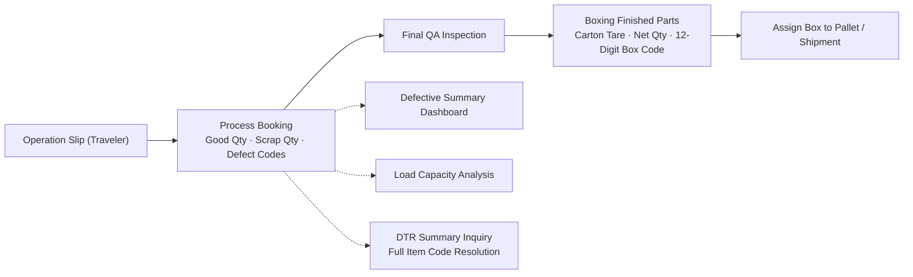

# Pillar 5: Production Process & Shop Floor Execution

The Production Process module governs day-to-day shop floor operations, routing completion bookings, quality defect logging, final box packaging, and real-time operational analytics.

---

## 📂 Production Process Domains

| Domain | Description | Detailed Documentation |
| :--- | :--- | :--- |
| **Shop Floor Execution** | Operation slip tracking, process booking, early-start authorization, boxing finished items, and shipment assignment. | [01. Production Control & Boxing](./production-control-boxing-booking-assigning-box.md) |
| **Monitoring & Analytics** | Work center load capacity, quality defect analysis, DTR summary with full item codes, and real-time process inquiry. | [02. Monitoring & Analytics](./load-capacity-defective-summary-dtr-monitoring.md) |

---

## 🔄 Shop Floor Operational Flow

---

## ⚡ Core Operational Standards

1. **Defect Tracking**: Rejection reasons (e.g., shrinkage porosity, slag inclusion, dimensional variance, crack) are recorded per station to drive scrap reduction.
2. **Sequential Boxing**: Boxes receive unique 12-digit numbers encoding date, month character, and daily series (e.g., `P26J13010001`).
3. **Full Item Code Resolution**: Monitoring inquiries and DTR summaries display the complete part engineering code (`itemCode`) alongside fabrication codes for unambiguous operator identification.
