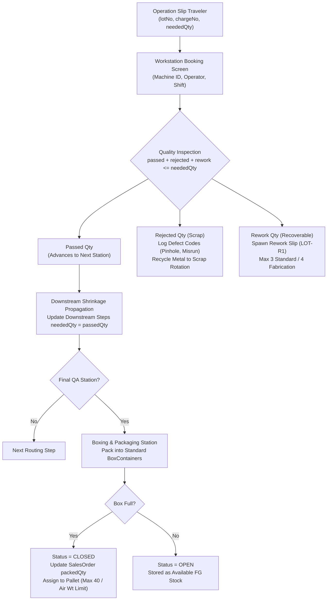
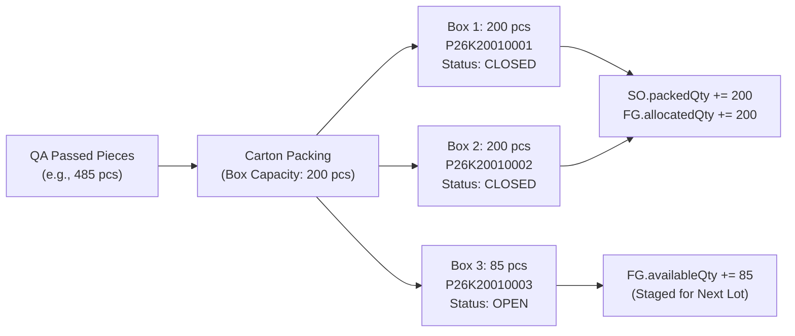
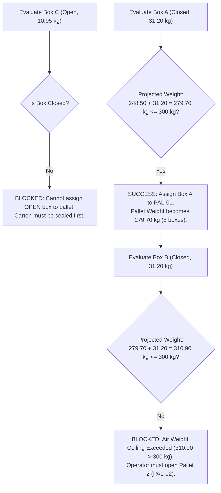

# Production Process: Production Control, Booking, Boxing & Box Assignment

Covers the physical execution, workstation booking, quality defect logging, shrinkage propagation, export boxing, and pallet assignment performed on the plant floor.

---

## 1. Production Control & Operation Slip Architecture

The **Operation Slip** (`OperationSlip`) serves as the official digital and physical manufacturing traveler that accompanies every precision casting or fabrication lot from raw wax injection to final warehouse boxing.



### Core Data Tracked on Operation Traveler
* **Identifiers**: `orderNo`, `lotNo` (e.g., `1`, `2`, `RM-01`, `RW-01`), and `chargeNo` (e.g., `440.3-X9-001`).
* **Item Master**: `itemCode`, customer name, alloy grade, and fabrication code (`fabCode`).
* **Quantities**: Starting lot quantity, active `neededQty`, and cumulative scrap count.
* **Sequential Routing Steps**: Item route steps followed by fabrication route steps, with station sign-offs.

---

## 2. Process Booking Engine & Rules

### Rule 1: Strict Quantity Conservation & Validation
At every operational station, the sum of all inspected pieces cannot exceed the step's incoming demand:

$$\text{totalInspectedQty} = \text{passedQty} + \text{rejectedQty} + \sum_{i=1}^{3} \text{reworkQty}_i$$

$$\text{totalInspectedQty} \le \text{neededQty}$$

> [!CAUTION]
> If $\text{totalInspectedQty} > \text{neededQty}$, the system rejects the booking transaction and flags an `INVALID_INPUT` error:
> `Total inspected quantity exceeds needed quantity.`

---

### Rule 2: Scrap Defect Segregation & Chemical Recycling
Rejected pieces cannot simply be discarded as a single bulk number. The operator must categorize scrap by section-specific defect codes:

* **Wax Room (`WaxDefect`)**: Bubble, Deformation, Short Shot, Wax Crack, Broken Pattern, Wax Inclusion, Sink Mark.
* **Ceramic Coating (`CoatingDefect`)**: Shell Crack, Slurry Lifting, Bubble on Pattern, Incomplete Coating, Shell Thinness.
* **Foundry Melting & Pouring (`CastingDefect`)**: Gas Pinhole, Oxide Film, Sand Inclusion, Slag Inclusion, Misrun / Cold Shut, Shrinkage Cavity.
* **Pre-Finishing & Finishing (`PrefinDefect`)**: Cut-off Over-grind, Gate Stump Protrusion, Blast Pitting, Heat Treat Warp.
* **Machine Shop (`FabDefect`)**: Tool Mark, Broken Tool, Surface Scratch, Hole Diameter Undersize/Oversize, Thread Pitch Defect, Geometric Tolerance (GTOS Flatness, Run-out, Concentricity).

> [!NOTE]
> Scrap metal from gate cut-off and casting rejections is automatically returned to the raw material warehouse rotation inventory (`RawMaterialRotation`) for remelting.

---

### Rule 3: Downstream Shrinkage Propagation
Precision casting experiences natural process yield fallout across sequential stages. When scrap is logged at an upstream process:
1. Current process is marked `Completed` with its `passedQty`.
2. The system queries all remaining downstream processes in the slip:
   $$\text{neededQty}_{\text{downstream}} \longleftarrow \text{passedQty}_{\text{current}}$$
3. The parent `ProductionSlip.totalQty` is updated to reflect the remaining good piece count.

---

### Rule 4: Automated Rework Slip Generation (`LOT-R1`)
When pieces have minor recoverable defects (e.g., small gate burrs requiring regrinding, minor tool marks):
* **Rework Lot Identifier**: `${parentLotNo}-R${reworkCount + 1}` (e.g., `Lot 1` $\rightarrow$ `1-R1`, `1-R2`).
* **Maximum Rework Limits**:
  * **Standard Investment Casting**: Maximum **3 reworks**.
  * **Fabrication Machining**: Maximum **4 reworks**.
  * *If limit is exceeded*: The system prohibits further rework; pieces must be booked as scrap (`rejectedQty`).
* **Chained Downstream Routing**:
  * **Step 1**: Dedicated rework step (`[REWORK] <Process Name>`) initialized with `neededQty = reworkTotal`.
  * **Steps 2..N**: Inherits all subsequent downstream processes from the parent traveler to ensure full thermal, surface, and quality processing.

---

## 3. Boxing & Finished Goods Inventory Rules



### Rule 5: Standard 12-Digit Box Container Numbering
Every carton generated on the plant floor receives a standardized serial identifier:

$$\mathbf{P} + \mathbf{\text{Year}} + \mathbf{\text{MonthCode}} + \mathbf{\text{Day}} + \mathbf{\text{Series}} + \mathbf{\text{Sequence}}$$

Example: `P26K20010001`
```
  P   26   K   20   01   0001
  │   │    │   │    │    └── Daily box sequence (0001..9999)
  │   │    │   │    └─────── Series identifier (01)
  │   │    │   └──────────── Day of the month (01..31)
  │   │    └──────────────── Month code (A=Jan, B=Feb ... K=Nov, L=Dec)
  │   └───────────────────── Year suffix (2026 -> 26)
  └───────────────────────── Prefix 'P' (Packing Carton)
```

---

### Rule 6: Box Status Lifecycle & Inventory State
* **`OPEN` Box**:
  * The carton remains unsealed on the packaging table.
  * More pieces from subsequent lots of the same item can be merged into it.
  * Inventory State: Logged as **`AVAILABLE`** stock in `FinishedGoodsLot`.
* **`CLOSED` Box**:
  * The carton is full, sealed with tamper-evident tape, and labeled.
  * Records `closedAt` timestamp and `closedById`.
  * Inventory State: Immediately converts from available to **`ALLOCATED`** stock in `FinishedGoodsLot`.
  * Updates Sales Order: Automatically increments `SalesOrder.packedQty += box.quantity`.

---

### Rule 7: Pallet Assignment Constraints (`AssignBox`)
Associates closed export boxes with scheduled shipping pallets:
1. **Status Gate**: Only boxes in `CLOSED` status can be assigned to a pallet. Open boxes are blocked.
2. **Item Compatibility**: Boxes assigned to the same pallet must share identical `itemId` and `fabCode`.
3. **Carton Capacity Ceiling**: Maximum **40 boxes** per pallet container.
4. **Air Freight Gross Weight Ceiling**:
   * For shipments where transport mode is `AIR`, total pallet gross weight cannot exceed carrier limits:
     $$\text{Box Net Weight} = \text{Box Qty} \times \text{Item.stdItemWt}$$
     $$\text{Box Gross Weight} = \text{Box Net Weight} + \text{BoxType.tareWeight}$$
     $$\text{Projected Pallet Weight} = \text{Current Pallet Weight} + \text{Box Gross Weight} \le \text{AIR\_PALLET\_MAX\_WEIGHT\_KG}$$
   * *If projected weight $> \text{limit}$*: Assignment is disabled with an `Air Weight Exceeded` warning.

---

## 4. Concrete Examples of Expected Groupings (Inputs vs. Results)

### Example 1: Standard Process Booking with Quality Defect Segregation & Shrinkage

An operator at the **Dewax & Pre-Heat** station receives a casting lot of turbine brackets.

#### 1. Input Workstation Data
* **Production Slip**: `Lot 1` of Sales Order `SO-2026-081`
* **Part Code**: `10-03913-000` (Inconel 718 Bracket)
* **Current Step**: Step 4 (`Dewaxing & Shell Pre-Heat`)
* **Incoming Needed Quantity**: **500 pcs**
* **Workstation Inspection Entry**:
  * **Passed Qty**: `470 pcs`
  * **Rejected Qty (Scrap)**: `20 pcs`
  * **Rework Qty 1**: `10 pcs` (Minor ceramic burr requiring regrind)
  * **Total Inspected**: $470 + 20 + 10 = 500\text{ pcs}$ ($= \text{neededQty}$, Valid).
* **Defect Categorization**:
  * `Shell Crack` (Coating Defect): 12 pcs
  * `Slurry Lifting` (Coating Defect): 8 pcs
  * Total logged defects: 20 pcs.

#### 2. System Execution & Shrinkage Walkthrough
1. **Booking Record Created**: Header `BK-1732092100-1` created with `totalInspectedQty = 500`.
2. **CoatingDefect Table Updated**: Shell Crack (12), Slurry Lifting (8).
3. **Step 4 Marked Completed**: `actualEndDate = NOW()`, `productionTime = 2.45 hours`.
4. **Downstream Shrinkage Propagation**:
   * All subsequent steps (Step 5 Melting, Step 6 Cut-off, Step 7 Gate Grinding, Step 8 Heat Treatment, Step 9 Inspection) have their `neededQty` automatically updated:
     $$\text{neededQty} \longleftarrow 470\text{ pcs}$$
   * Parent `ProductionSlip.totalQty` updated from $500 \rightarrow 470\text{ pcs}$.

#### 3. Resulting Output State

| Routing Step | Process Name | Old Needed Qty | New Needed Qty | Step Status | Notes |
| :---: | :--- | :---: | :---: | :---: | :--- |
| **Step 4** | **Dewaxing & Pre-Heat** | 500 pcs | **470 pcs** | `Completed` | 20 scrap + 10 rework logged |
| **Step 5** | **Melting & Pouring** | 500 pcs | **470 pcs** | `Pending` | Shrunk by 30 pcs |
| **Step 6** | **Shell Knockout & Cut-off** | 500 pcs | **470 pcs** | `Pending` | Shrunk by 30 pcs |
| **Step 7** | **Gate Grinding** | 500 pcs | **470 pcs** | `Pending` | Shrunk by 30 pcs |
| **Step 8** | **Heat Treatment** | 500 pcs | **470 pcs** | `Pending` | Shrunk by 30 pcs |
| **Step 9** | **Final QA & Boxing** | 500 pcs | **470 pcs** | `Pending` | Shrunk by 30 pcs |

---

### Example 2: Automatic Rework Slip Generation & Chained Downstream Routing

Continuing from Example 1, the **10 pieces** flagged for rework must be rectified and re-integrated without losing traceability.

#### 1. Input Trigger
* `reworkQty1 = 10 pcs` from `Lot 1` at Step 4.
* Existing reworks for `Lot 1`: `0` ($< 3$, within limit).

#### 2. System Execution
1. The engine generates a new child production slip:
   * **Slip Lot Number**: `1-R1` (`type = REWORK`).
   * **Total Quantity**: `10 pcs`.
   * **Remarks**: `Rework #1 generated from process [Dewaxing & Pre-Heat] on Lot 1`.
2. **Routing Step Construction for `1-R1`**:
   * **Step 1 (The Rework Action)**: `[REWORK] Gate Grinding & Surface Cleaning`, `neededQty = 10`.
   * **Step 2 (Downstream Flow)**: `Melting & Pouring`, `neededQty = 10`.
   * **Step 3 (Downstream Flow)**: `Shell Knockout & Cut-off`, `neededQty = 10`.
   * **Step 4 (Downstream Flow)**: `Heat Treatment`, `neededQty = 10`.
   * **Step 5 (Downstream Flow)**: `Final QA & Boxing`, `neededQty = 10`.

#### 3. Resulting Shop Floor Slips

| Traveler / Slip | Slip Type | Total Qty | Active Process | Status |
| :--- | :---: | :---: | :--- | :---: |
| **`Lot 1`** (Parent) | `ORIGINAL` | **470 pcs** | Step 5: Melting & Pouring | `In-Progress` |
| **`1-R1`** (Child) | `REWORK` | **10 pcs** | Step 1: `[REWORK] Gate Grinding` | `Pending` |

> [!TIP]
> Both travelers now move independently across the shop floor with dedicated barcodes, preventing small rework delays from stalling the main production run of 470 good pieces.

---

### Example 3: Final Boxing — Full Cartons + Open Partial Carton Allocation

The 470 pieces from `Lot 1` arrive at Step 9 (Final QA & Boxing). 465 pieces pass final inspection; 5 pieces are rejected for surface pits.

#### 1. Input Specifications
* **Good Pieces to Pack**: `465 pcs`
* **Box Type**: `STD-CARTON-200` (Standard capacity: **200 pieces per box**, tare weight: `1.20 kg`)
* **Part Standard Weight (`stdItemWt`)**: `0.150 kg/pc`
* **Sales Order**: `SO-2026-081` (`orderQty = 500 pcs`, current `packedQty = 0`)
* **Packing Date**: November 20, 2026 (`Year: 26`, `Month: K`, `Day: 20`)

#### 2. Calculation & Packing Walkthrough
1. **Carton Capacity Division**:
   $$\text{Full Boxes} = \left\lfloor \frac{465}{200} \right\rfloor = 2\text{ boxes of 200 pcs}$$
   $$\text{Partial Box} = 465 - (2 \times 200) = 65\text{ pcs in a third box}$$
2. **Box Container Generation**:
   * **Box 1**: `P26K20010001` $\rightarrow$ 200 pcs $\rightarrow$ Marked **`CLOSED`**.
   * **Box 2**: `P26K20010002` $\rightarrow$ 200 pcs $\rightarrow$ Marked **`CLOSED`**.
   * **Box 3**: `P26K20010003` $\rightarrow$ 65 pcs $\rightarrow$ Left **`OPEN`** (waiting for `Lot 2` or `1-R1` to top off).
3. **Weight Calculations**:
   * **Box 1 & 2 Net Wt**: $200 \times 0.150\text{ kg} = 30.00\text{ kg}$ | **Gross Wt**: $30.00 + 1.20 = \mathbf{31.20\text{ kg}}$.
   * **Box 3 Net Wt**: $65 \times 0.150\text{ kg} = 9.75\text{ kg}$ | **Gross Wt**: $9.75 + 1.20 = \mathbf{10.95\text{ kg}}$.
4. **Inventory & Sales Order Updates**:
   * **Closed Boxes (400 pcs)**:
     * `FinishedGoodsLot.allocatedQty` incremented by `+400 pcs`.
     * `SalesOrder.packedQty` incremented by `+400 pcs` (now 400 / 500 fulfilled).
   * **Open Box (65 pcs)**:
     * `FinishedGoodsLot.availableQty` incremented by `+65 pcs` (staged as available warehouse stock).

#### 3. Resulting Box Summary

| Box Number | Quantity | Status | Net Weight | Gross Weight | Inventory State | Sales Order packedQty |
| :--- | :---: | :---: | :---: | :---: | :---: | :---: |
| **`P26K20010001`** | **200 pcs** | **`CLOSED`** | 30.00 kg | 31.20 kg | `ALLOCATED` | +200 pcs |
| **`P26K20010002`** | **200 pcs** | **`CLOSED`** | 30.00 kg | 31.20 kg | `ALLOCATED` | +200 pcs |
| **`P26K20010003`** | **65 pcs** | **`OPEN`** | 9.75 kg | 10.95 kg | `AVAILABLE` | 0 (Awaiting closure) |

---

### Example 4: Assigning Boxes to Pallet with Airfreight Weight Ceiling Check

Packaging operators assign boxed cartons to Pallet 1 of an airfreight export shipment.

#### 1. Input Specifications
* **Shipment**: `SHP-2026-AIR-04` (`transportMode = AIR`)
* **Air Pallet Maximum Gross Weight**: `300.00 kg` (`AIR_PALLET_MAX_WEIGHT_KG`)
* **Current Pallet State**:
  * Pallet: `PAL-01`
  * Current Box Count: `7 boxes`
  * Current Total Weight: `248.50 kg`
* **Candidate Closed Boxes Awaiting Assignment**:
  * Box A (`P26K20010001`): Gross Weight = `31.20 kg` (Status: `CLOSED`)
  * Box B (`P26K20010002`): Gross Weight = `31.20 kg` (Status: `CLOSED`)
  * Box C (`P26K20010003`): Gross Weight = `10.95 kg` (Status: `OPEN`)

#### 2. Evaluation Step-by-Step



1. **Attempt Box C Assignment**:
   * Box C has `status = OPEN`.
   * **Result**: Hard validation rejection. The UI disables the assign action:
     `Cannot assign open box to shipment pallet. Close box container first.`
2. **Attempt Box A Assignment**:
   * Status = `CLOSED` (Pass).
   * Projected Weight: $248.50\text{ kg} + 31.20\text{ kg} = \mathbf{279.70\text{ kg}} \le 300.00\text{ kg}$ (Pass).
   * Box Count: $7 + 1 = 8 \le 40$ (Pass).
   * **Result**: Box A assigned to `PAL-01` with `sequenceInPallet = 8`.
3. **Attempt Box B Assignment**:
   * Status = `CLOSED` (Pass).
   * Projected Weight: $279.70\text{ kg} + 31.20\text{ kg} = \mathbf{310.90\text{ kg}} > 300.00\text{ kg}$ (**Exceeds Air Limit!**).
   * **Result**: Hard block. The system displays:
     `Air Freight Weight Exceeded. Adding Box P26K20010002 would result in 310.90 KG, exceeding the 300 KG limit for air pallets.`
   * **Action**: Operator opens a new pallet container (`PAL-02`) to accommodate Box B.

---

### Example 5: Reassigning Orphaned Unpalletized Boxes to Another Sales Order

A customer cancels Order `SO-2026-040` after manufacturing completed. 2 closed boxes (400 pcs of part `10-03913-000`) sit unpalletized in the shipping warehouse.

#### 1. Input Specifications
* **Orphaned Box**: `P26J15010001` (200 pcs, part `10-03913-000`, `status = CLOSED`, `palletContainerId = null`)
* **New Incoming Sales Order**: `SO-2026-095` for part `10-03913-000`, `orderQty = 200 pcs`, `packedQty = 0`.

#### 2. Reassignment Process
1. Shipping coordinator navigates to **Boxing Management $\rightarrow$ Open & Orphaned Boxes**.
2. Selects orphaned box `P26J15010001`.
3. Selects target Sales Order `SO-2026-095`.
4. **Validation Check**:
   * Part compatibility: Box part (`10-03913-000`) matches Order part (`10-03913-000`) $\implies$ **Approved**.
5. **System Updates**:
   * `BoxContainer.salesOrderId` updated from `SO-2026-040` $\rightarrow$ `SO-2026-095`.
   * `BoxContainer.orderNo` updated to `SO-2026-095`.
   * `SalesOrder.packedQty` for `SO-2026-095` automatically increments by `+200 pcs` (order 100% fulfilled without casting a single piece!).
   * Audit log recorded:
     `Assigned 1 closed box (P26J15010001) to Sales Order SO-2026-095.`

---

## 5. Summary Reference Cheat Sheet

| Operation / Event | Condition / Rule | System Behavior |
| :--- | :--- | :--- |
| **Quantity Validation** | $\text{Inspected} > \text{Needed}$ | Blocks booking; displays error with exact excess count. |
| **Defect Logging** | $\text{rejectedQty} > 0$ | Demands specific defect classification; scrap recycled to raw inventory. |
| **Shrinkage Update** | Any scrap logged upstream | Automatically cascades $\text{neededQty} = \text{passedQty}$ to all downstream steps. |
| **Rework Creation** | $\text{reworkQty} > 0$ | Spawns `LOT-R1` child traveler with Step 1 `[REWORK]` followed by downstream routing. |
| **Rework Ceiling** | Rework count $\ge 3$ (std) or $4$ (fab) | Hard block on further rework; pieces must be booked as scrap. |
| **Box Status = OPEN** | Incomplete carton | Pieces placed in `FinishedGoodsLot.availableQty`; does not advance `packedQty`. |
| **Box Status = CLOSED** | Full, sealed carton | Pieces convert to `FinishedGoodsLot.allocatedQty`; increments `SalesOrder.packedQty`. |
| **Pallet Box Ceiling** | Cartons in pallet $\ge 40$ | Blocks further box assignment; forces opening of next pallet container. |
| **Airfreight Limit** | Total pallet wt $> 300\text{ kg}$ | Blocks assignment; protects against airport carrier weight rejections. |
