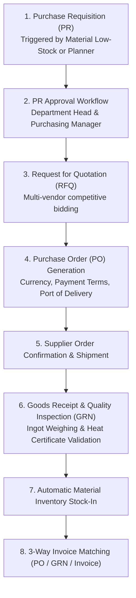

# Pillar 6: Purchase Management (Roadmap)

> [!NOTE]
> **Status: Planned / Roadmap (Not Yet Implemented)**
> This module outlines the planned procurement workflows, vendor purchase order management, and goods receipt procedures for CASTEM Philippines.

---

## 1. Module Overview & Objectives

The Purchase module will automate and streamline the procurement lifecycle for:
1. **Raw Metal Materials & Ingots**: Purchasing certified metal alloy ingots from domestic and international suppliers.
2. **Foundry Consumables & Chemicals**: Wax blocks, ceramic slurries, zircon stuccoing sands, crucibles, and degassing agents.
3. **Tooling & Spare Parts**: Injection mould components, cutting discs, grinding belts, thermocouples, and maintenance spares.
4. **Packaging Materials**: Corrugated boxes, plastic pallets, stretch wrap, and thermal printing ribbon.

---

## 2. Planned Functional Workflow

---

## 3. Core Entities to be Implemented

* `PurchaseRequisition` (`PR`): Internal department material request with budget and priority tags.
* `PurchaseOrder` (`PO`): Legally binding procurement contract sent to suppliers detailing item, quantity, unit price, delivery terms, and currency (`USD`, `JPY`, `PHP`).
* `GoodsReceiptNote` (`GRN`): Physical receiving record capturing gross weight, tare weight, supplier heat numbers, and inspection pass/fail status.
* `VendorQuotation`: Price history comparison across approved suppliers.
