# Pillar 3: Sales Order & Shipping Logistics

The Sales Order and Shipping module manages customer demand, fulfillment tracking, pallet staging, box consolidation, shipping sticker generation, and international export customs documentation.

---

## 📂 Sales Order & Shipping Domains

| Domain | Description | Detailed Documentation |
| :--- | :--- | :--- |
| **Sales Order Management** | Customer purchase order processing, order lines, delivery schedules, and fulfillment lifecycle. | [01. Sales Order](./sales-order.md) |
| **Shipping & Pallet Logistics** | Pallet creation, box allocation rules, pallet sealing, per-pallet sticker printing, and multi-format document generation. | [02. Shipping & Pallets](./shipping-pallet-assignment.md) |

---

## 🔄 Commercial & Fulfillment Lifecycle

```mermaid
flowchart LR
    CustomerPO["Customer PO"] --> SalesOrder["Sales Order Confirmation"]
    SalesOrder --> Allocation["FG Inventory Allocation"]
    Allocation --> PalletStaging["Pallet Assignment & Staging"]
    PalletStaging --> PrintStickers["Per-Pallet Sticker Printing"]
    PrintStickers --> PalletSealing["Pallet Sealing (QA & Logistics Sign-off)"]
    PalletSealing --> Finalize["Shipment Finalization"]
    Finalize --> ExportDocs["Document Generation<br/>PDF & Excel Packages"]
    ExportDocs --> ShipOut["Ship-Out Execution<br/>Inventory Deducted"]
```

---

## ⚡ Core Compliance & Engineering Rules

1. **40-Box / 300kg Pallet Rules**:
   * Standard pallets hold up to 40 boxes. Air shipments enforce a maximum gross weight threshold of 300 kg per pallet unless forced.
2. **Heaviest-First Sorting**:
   * Boxes are dynamically allocated into pallets sorted by heaviest box first, keeping tail boxes together.
3. **Per-Pallet Sticker Printing & Scoping**:
   * Dedicated pallet switcher allows printing stickers specifically for the active pallet, pre-selecting only relevant boxes.
4. **Standardized Currency & Returnable Packaging**:
   * Japanese Yen is strictly exported as **`JPY`**.
   * Returnable pallets for `CJC` and `CAC` customers automatically include unit price (default **¥3,300 JPY**) and amount calculations in commercial export invoices.
