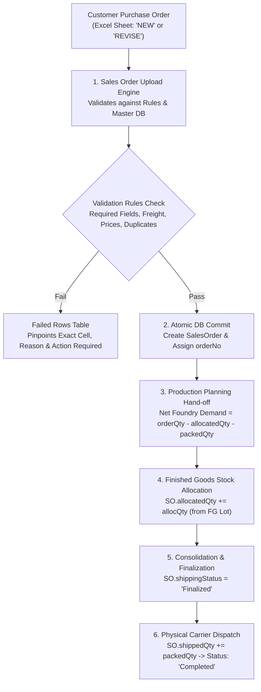
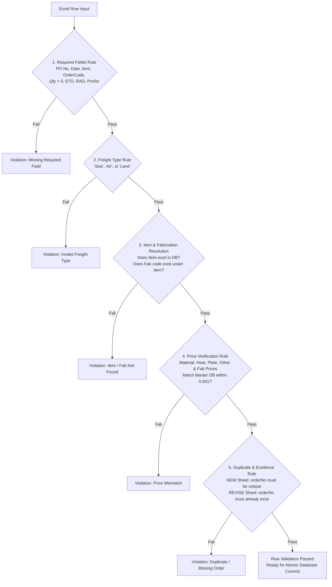

# Sales Order: Order Management, Batch Upload & Fulfillment Rules

Manages customer contract orders, item specifications, pricing validation, delivery dates, and the complete order lifecycle from initial PO entry to final carrier dispatch.

---

## 1. Sales Order Architecture & Attributes

A **Sales Order** represents an accepted, binding commercial contract with a customer (e.g., Canon, CJC, CAC, Makoto, Line Seiki).



### Core Data Tracked on Sales Order (`SalesOrder`)
* **Contract Identifiers**: `id`, `orderNo` (internal/customer order code, e.g., `ORD-2026-001`, `PO-5334852`), `salesOrderNo` (Customer PO number), and `orderCode`.
* **Part Reference**: `itemId`, `itemCode`, `fabricationId`, and `fabCode` (e.g., `10-03913-000` base casting vs. `10-03913-100` machined variant).
* **Quantities**: `orderQty` (contracted pieces), `allocatedQty` (reserved from FG warehouse), `packedQty` (carton-boxed), `shippedQty` (carrier-dispatched), and `productionQty` (net foundry requirement).
* **Commercial Terms**: Billing currency (`JPY`, `USD`, `PHP`), `materialPrice`, `heatPrice`, `platePrice`, `otherPrice`, and `fabPrice`.
* **Delivery Schedule**: `salesOrderDate`, `requestedETD` (departure target), `rad` (Required Arrival Date at destination port), and `freightType` (`Sea`, `Air`, `Land`).
* **Progression States**:
  * `status`: `Draft` $\rightarrow$ `Confirmed` $\rightarrow$ `In-Production` $\rightarrow$ `Completed` $\rightarrow$ `Cancelled`.
  * `shippingStatus`: `Pending` $\rightarrow$ `Allocated` $\rightarrow$ `Finalized` $\rightarrow$ `Shipped`.

---

## 2. Batch Upload Rules: Successful Upload vs. Failed Items

When sales coordinators import customer POs via Excel, the **Sales Order Validation & Rule Engine** audits every row against 5 strict deterministic rules before committing any record to the database.



---

### Rule 1: Required Fields Validation (`RequiredFieldsRule`)
Core mandatory fields must be present and non-empty:

| Field | Requirement / Validation | Failure Reason If Invalid | Action Required |
| :--- | :--- | :--- | :--- |
| `salesOrderNo` | Non-empty string | `PO number (salesOrderNo) is required and cannot be blank.` | Provide a valid PO number in the Excel sheet. |
| `salesOrderDate`| Valid ISO/Excel date | `PO Date (salesOrderDate) is required.` | Provide a valid PO date. |
| `itemCode` | Non-empty string | `Item Code (itemCode) is required.` | Provide a valid Item Code registered in Item Master. |
| `orderCode` | Non-empty string | `Order Code (orderCode) is required.` | Enter the customer's order line code. |
| `orderQty` | Integer $> 0$ | `Order Quantity must be greater than 0. Received: 0` | Enter a positive piece count. |
| `requestedETD` | Valid date | `Requested ETD (requestedETD) is required.` | Provide customer requested departure date. |
| `rad` | Valid date | `RAD / Required Arrival Date (rad) is required.` | Provide customer destination arrival deadline. |
| `prodNo` | Non-empty string | `Production / Pro Number (prodNo) is required.` | Provide a valid Pro number. |
| `orderNo` | Non-empty string *(REVISE sheet only)* | `Order No is required for REVISE sheet to identify the existing order.` | Specify the existing Order No to revise. |

---

### Rule 2: Freight Type Normalization (`FreightTypeRule`)
* **Allowed Values**: `Sea`, `Land`, `Air` (case-insensitive).
* **Default**: If omitted or left blank in Excel, the engine automatically defaults to **`Sea`**.
* **Failure Condition**: Any value outside `Sea`, `Land`, or `Air` (e.g., `TRUCK`, `EXPEDITE`, `VESSEL`) triggers a hard failure:
  * *Reason*: `Invalid Freight Type: 'TRUCK'. Allowed values: Sea, Land, Air.`
  * *Action*: `Change freight type to 'Sea', 'Land', or 'Air'.`

---

### Rule 3: Item Resolution & Fabrication Extension Code (`ItemResolutionRule`)
In CASTEM, parts are identified by a 12-character format with a 3-digit suffix (`XX-XXXXX-YYY`):
* `000` suffix denotes a **Base Raw Casting** (e.g., `10-03913-000`).
* Non-`000` suffix denotes a **Secondary Machined / Fabrication Variant** (e.g., `10-03913-100`, `20-02872-300`).

#### Resolution Logic
1. The engine splits the uploaded code into `baseCode` and `fabSuffix`.
2. Searches the `Item` master for `itemCode = rawCode` or `itemCode = baseCode`.
   * *If Item does not exist*: **Fails**:
     `Item code '10-99999-000' not found in Item Master.`
3. If a fabrication suffix exists (e.g., `-100`), searches the `Fabrication` table under that item:
   * *If Fabrication code does not exist*: **Fails**:
     `Fabrication code '100' for Item '10-03913-000' not found in Fabrication Master.`
   * *Action Required*: Register the fabrication code under the item in Fabrication Master before importing.

---

### Rule 4: Price Verification & Auto-Population (`PriceVerificationRule`)
Guarantees commercial billing accuracy by cross-referencing uploaded prices against engineering master pricing:
* **Checked Price Components**:
  * `materialPrice` (Raw alloy cost per piece)
  * `heatPrice` (Melting & pouring processing cost)
  * `platePrice` (Surface plating / coating cost)
  * `otherPrice` (Secondary operations / tooling amortization)
  * `fabPrice` (CNC machining / thread tapping unit price)
* **Auto-Population of Zero Prices**:
  * If Excel provides `0` (or blank) and the Master DB has a positive price ($> 0$), the system **approves** the row and auto-populates the missing price directly from the Master DB!
* **Mismatch Detection (Tolerance: $0.001$)**:
  * If Excel provides a positive price that differs from the Master DB ($|\text{Excel} - \text{DB}| > 0.001$), the row **fails**:
    * *Reason*: `Price mismatch for Material Price: Excel has 150.00 but Master DB has 142.50.`
    * *Action*: `Update the Excel file to match Item Master (142.50) or update the Item Master price.`
* **Base Item Fabrication Price Prohibition**:
  * If the item is a base casting (`-000`) without a fabrication extension, but the Excel sheet supplies a `fabPrice > 0`:
    * *Reason*: `Item code '11-07658-000' does not have a fabrication extension code, but a fabrication price of 25.00 was provided.`
    * *Action*: `Remove the fabrication price for this base item or specify an item code with a fabrication extension.`

---

### Rule 5: Duplicate Check & Sheet Context (`OrderExistenceAndDuplicateRule`)
* **For `NEW` Sheet Uploads**:
  * For preset customer codes (`CAC`, `CJC`), the uploaded `orderNo` must be unique across the batch and must not already exist in the database.
  * *If duplicate exists in DB*: **Fails**:
    `Order No 'PO-CAC-8819' already exists in the database. Use the REVISE sheet if you want to update an existing order.`
* **For `REVISE` Sheet Uploads**:
  * The uploaded `orderNo` must already exist in the database.
  * *If order not found in DB*: **Fails**:
    `Sales Order with Order No 'ORD-UNKNOWN-99' does not exist in the database. Use the NEW sheet if this is a new order.`

---

## 3. Concrete Examples of Upload Scenarios (Inputs vs. Results)

### Example 1: Successful Upload of New Multi-Line Customer PO

A coordinator uploads a `NEW` sheet containing 2 valid order lines for customer **CAC**.

#### Input Excel Rows

| Row | PO Number (`salesOrderNo`) | PO Date | Item Code | Order Code | Qty | Req ETD | RAD | Pro No | Mat Price | Fab Price | Freight |
| :---: | :--- | :---: | :--- | :--- | :---: | :---: | :---: | :---: | :---: | :---: | :---: |
| #1 | `PO-CAC-2026-001` | 2026-11-20 | `10-03913-000` | `ORD-A1` | 500 | 2026-12-15 | 2026-12-25 | `PRO-881` | 0.00 | 0.00 | `Sea` |
| #2 | `PO-CAC-2026-001` | 2026-11-20 | `10-03913-100` | `ORD-A2` | 300 | 2026-12-10 | 2026-12-18 | `PRO-882` | 142.50 | 35.00 | `Air` |

#### Master Database Records
* Item `10-03913-000`: Base casting exists; `materialPrice = 142.50`.
* Item `10-03913-100`: Fabrication code `100` exists under item; `materialPrice = 142.50`, `fabUnitPrice = 35.00`.

#### Validation & Ingestion Result
* **Row #1 Evaluation**:
  * Base casting (`-000`), no fabrication price required.
  * Excel `matPrice = 0.00` $\rightarrow$ System auto-populates `142.50` from Master DB.
  * Freight = `Sea` (Valid).
  * ➔ **PASS**.
* **Row #2 Evaluation**:
  * Fabrication item (`-100`), `fabPrice = 35.00` matches DB `35.00`.
  * `matPrice = 142.50` matches DB `142.50`.
  * Freight = `Air` (Valid).
  * ➔ **PASS**.
* **Final Batch Result**: **`2 / 2 Rows Uploaded Successfully`**. Orders created with status `Confirmed` and handed off to Production Planning.

---

### Example 2: Failed Item — Price Mismatch Rejection

A customer PO has outdated contract prices in Excel that do not reflect the updated raw metal surcharge in Item Master.

#### Input Excel Row
* **Item Code**: `10-03913-000`
* **Excel Material Price**: `120.00`
* **Master DB Material Price**: `142.50`

#### Upload Execution Result
* **Status**: **`FAILED`**
* **Error Modal Display**:
  ```json
  {
    "rowNumber": 4,
    "field": "materialPrice",
    "reason": "Price mismatch for Material Price: Excel has 120.00 but Master DB has 142.50.",
    "actionRequired": "Update the Excel file to match Item Master (142.50) or update the Item Master."
  }
  ```
* **Database Impact**: Zero rows committed. The batch is safely rolled back.

---

### Example 3: Failed Item — Unregistered Fabrication Extension Code

The sales coordinator uploads an order for a new secondary machined variant that has not been configured in engineering master data yet.

#### Input Excel Row
* **Uploaded Item Code**: `20-02872-300` (Machined Flange with `-300` precision grind)

#### Master DB State
* Base Item `20-02872-000` exists.
* Available Fabrication codes in Master: `100` (Rough Turn), `200` (Milled). Code **`300`** is missing!

#### Upload Execution Result
* **Status**: **`FAILED`**
* **Error Modal Display**:
  ```json
  {
    "rowNumber": 7,
    "field": "itemCode",
    "reason": "Fabrication code '300' for Item '20-02872-000' not found in Fabrication Master.",
    "actionRequired": "Register fabrication code '300' under item '20-02872-000' in Master Data."
  }
  ```

---

### Example 4: Failed Item — Base Item with Illegal Fabrication Price

The coordinator mistakenly enters a machining price for a raw unmachined casting.

#### Input Excel Row
* **Item Code**: `11-07658-000` (Raw Investment Cast Impeller Blank)
* **Excel Fab Price**: `45.00`

#### Upload Execution Result
* **Status**: **`FAILED`**
* **Error Modal Display**:
  ```json
  {
    "rowNumber": 12,
    "field": "fabPrice",
    "reason": "Item code '11-07658-000' does not have a fabrication extension code, but a fabrication price of 45.00 was provided.",
    "actionRequired": "Remove the fabrication price for this base item or specify an item code with a fabrication extension."
  }
  ```

---

### Example 5: Successful Order Revision (`REVISE` Sheet)

Customer requests an increase in ordered quantity and an earlier delivery date for an existing confirmed order.

#### Input Excel Row (`REVISE` Sheet)
* **Order No**: `ORD-2026-081` (Existing in DB, original qty: 500 pcs)
* **New Order Qty**: `600 pcs`
* **New Requested ETD**: `2026-11-28` (Moved forward from Dec 05)

#### Execution Result
1. `OrderExistenceAndDuplicateRule` verifies `ORD-2026-081` exists in the database $\implies$ **PASS**.
2. Checks that current order `shippedQty = 0` (Can safely be revised).
3. System updates `SalesOrder.orderQty = 600` and `SalesOrder.requestedETD = 2026-11-28`.
4. Creates audit entry in `SalesOrderAdjustment` logging the delta of `+100 pcs`.
5. Prompts Production Planning that order `ORD-2026-081` requires re-scheduling.

---

## 4. Sales Order Lifecycle Summary Cheat Sheet

| Order State | Trigger Event | Allowed Operations | Inventory & Planning State |
| :--- | :--- | :--- | :--- |
| **`Draft` / `Confirmed`** | Batch Excel Upload or Manual Entry | Edit terms, revise pricing, delete | No physical inventory held. Net demand sent to Scheduler. |
| **`In-Production`** | Production Plan generated | Re-schedule, generate travelers | Foundry lots actively progressing through shop floor. |
| **`Allocated`** | FG Allocation approved | Cancel allocation, bin movement | Goods locked in `FinishedGoodsLot.allocatedQty`. |
| **`Finalized`** | Pallet consolidated & sealed | Print stickers, export invoice | Cartons staged in shipping marshaling lanes. |
| **`Shipped`** | Carrier departure sign-off | View documents, print packing list | `allocatedQty` deducted; `SalesOrder.shippedQty` updated. |
| **`Completed`** | $\text{shippedQty} \ge \text{orderQty}$ | Archival inquiry | Commercial contract 100% fulfilled. |
