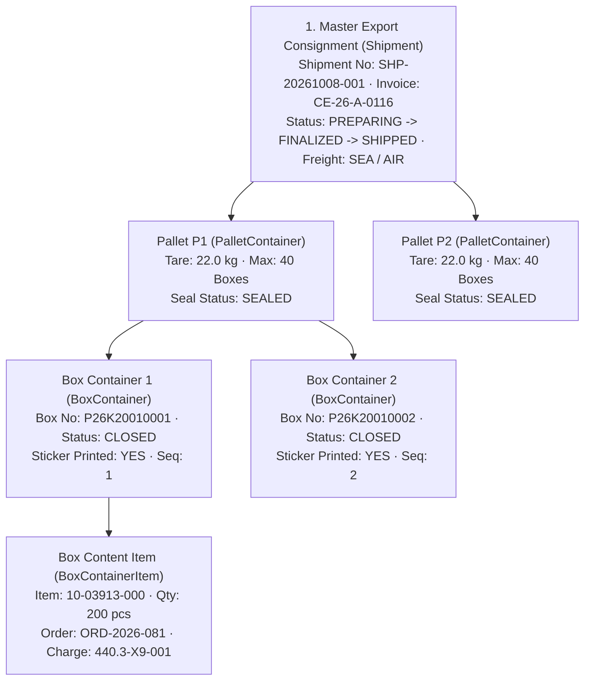
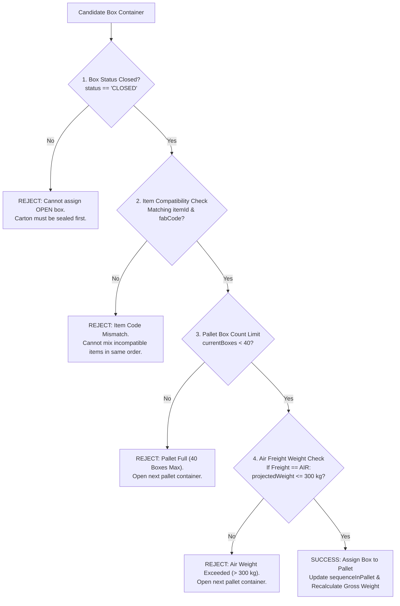
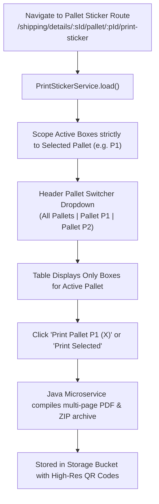

# Sales Order: Shipping, Pallet Assignment & Export Documentation Rules

Governs finished goods consolidation, export pallet construction, thermal box labeling, shipping sticker printing, shipment finalization gates, inventory deduction, and official international export customs documents (PDF & Excel).

---

## 1. Shipping Architecture & Container Hierarchy

The shipping system enforces a strict 4-tier container hierarchy for international freight compliance:



### Core Shipping Entities & Keys
* **Shipment (`Shipment`)**:
  * `shipmentNo`: System generated consignment code (e.g., `SHP-20261008-001`).
  * `invoiceNo`: Annual sequential commercial invoice code (e.g., `CE-26-A-0116`).
  * `freightType`: `SEA`, `AIR`, or `LAND`.
  * `status`: `PREPARING` $\rightarrow$ `FINALIZED` $\rightarrow$ `SHIPPED`.
  * `currency`: Official billing currency (**`JPY`**, strictly never `JPN`).
* **Pallet Container (`PalletContainer`)**:
  * `palletNo`: Consignment pallet identifier (`P1`, `P2`, `P3`...).
  * `palletTypeId`: Pallet specification (e.g., Standard Plastic Export Pallet, 1100x1100 mm).
  * `tareWeight`: Empty pallet weight (typically `22.00 kg`).
  * `sealStatus`: `UNSEALED` (open for box additions) or `SEALED` (locked and wrapped).
* **Box Container (`BoxContainer`)**:
  * `boxNo`: 12-digit standard code (e.g., `P26K20010001`).
  * `status`: Must be `CLOSED` to be eligible for palletizing.
  * `stickerPrinted`: Boolean flag indicating if thermal QR shipping label was generated.
  * `sequenceInPallet`: Box order index within the pallet (1..40).

---

## 2. Proper Pallet Assignment Rules



### Rule 1: Box Sealed / Closed Gate
* Only cartons with `status = "CLOSED"` are eligible for pallet assignment.
* Cartons in `OPEN` status are actively blocked in the UI to prevent unverified quantities from entering international customs manifests.

---

### Rule 2: 40-Box Pallet Ceiling
* A single pallet container cannot hold more than **40 boxes**.
* Once 40 boxes are assigned, the pallet is marked full, and subsequent cartons must be assigned to the next pallet (`P2`, `P3`...).

---

### Rule 3: Air Freight 300 kg Gross Weight Ceiling
For consignments dispatched via `AIR` (`freightType = "AIR"`), airline pallet payload safety constraints are strictly enforced:

$$\text{Box Net Weight} = \text{Box Qty} \times \text{Item.stdItemWt}$$

$$\text{Box Gross Weight} = \text{Box Net Weight} + \text{BoxType.tareWeight}$$

$$\text{Projected Pallet Weight} = \text{Current Pallet Weight} + \text{Box Gross Weight}$$

$$\text{Projected Pallet Weight} \le \mathbf{300.00\text{ kg}} \quad (\text{AIR\_PALLET\_MAX\_WEIGHT\_KG})$$

> [!CAUTION]
> If adding a box causes $\text{Projected Pallet Weight} > 300.00\text{ kg}$, the assignment is blocked:
> `Air Freight Weight Exceeded. Adding Box would result in 310.90 KG, exceeding the 300 KG limit for air pallets.`

---

### Rule 4: Heaviest-First Allocation with Tail Grouping
To maintain physical pallet stability:
* Heavy cartons are stacked at the base of the pallet.
* Partial/tail cartons are kept grouped with their parent sales order to prevent fragmented shipments across multiple pallets.

---

### Rule 5: Floating Pallet Staging
* Pallets can be constructed in advance as **Floating Pallets** in the warehouse before being linked to an export shipment.
* Once a shipment manifest is scheduled, floating pallets are assigned in bulk via `assignPalletsToShipment`.

---

## 3. Shipment Finalization & Ship-Out Rules

### Finalization Gate Rules (`finalize`)
Before a shipment can transition from `PREPARING` to `FINALIZED`, the system enforces a strict quality gate:

1. **Active Pallet Count**: Must contain at least **1 pallet**.
2. **Seal Enforcement**: **All pallets must be SEALED** (`sealStatus === "SEALED"`).
   * *If any pallet is unsealed*: **Blocked**:
     `Cannot finalize shipment. 1 pallet(s) are still UNSEALED. All pallets must be sealed before finalizing.`
3. **Sticker Printing Enforcement**: **All boxes must have printed shipping stickers** (`stickerPrinted === true`).
   * *If any box is unprinted*: **Blocked**:
     `Cannot finalize shipment. 8 box(es) do not have printed stickers yet. All boxes must have printed stickers and all pallets must be sealed before finalizing.`
4. **Order Status Synchronization**:
   * Upon successful finalization:
     $$\text{Shipment.status} \longleftarrow \text{"FINALIZED"}$$
     $$\forall \text{ SalesOrder} \in \text{Shipment: } \quad \text{SalesOrder.shippingStatus} \longleftarrow \text{"Finalized"}$$

> [!NOTE]
> Planners can invoke **Undo Finalize** if emergency carton changes are required prior to carrier loading. This returns the shipment to `PREPARING` and unfreezes linked sales orders.

---

### Ship-Out Execution Rules (`shipOut`)
When the freight carrier (e.g., DHL, Kintetsu, Ocean Line) takes custody at the loading dock:

1. **Pre-Condition**: Shipment must be in **`FINALIZED`** status.
2. **Status Updates**:
   $$\text{Shipment.status} \longleftarrow \text{"SHIPPED"}$$
   $$\forall \text{ BoxContainer} \in \text{Shipment: } \quad \text{BoxContainer.status} \longleftarrow \text{"SHIPPED"}$$
3. **Physical Inventory Deduction**:
   * For every item in every box, the engine deducts physical stock from `FinishedGoodsLot`:
     $$\text{allocatedQty}_{\text{new}} \longleftarrow \max\bigl(0,\, \text{allocatedQty}_{\text{old}} - \text{boxItem.quantity}\bigr)$$
   * Writes an immutable outbound transaction in `FinishedGoodsTransaction`:
     * `transactionType = "SHIPMENT"`
     * `direction = "OUTBOUND"`
     * `toStatus = "SHIPPED"`
     * `referenceNo = shipment.invoiceNo`
4. **Sales Order Completion**:
   $$\text{SalesOrder.shippedQty} \longleftarrow \text{SalesOrder.shippedQty} + \text{boxItem.quantity}$$
   $$\text{SalesOrder.shippingStatus} \longleftarrow \text{"Shipped"}$$
   * If $\text{shippedQty} \ge \text{orderQty}$, the sales order status updates to **`Completed`**.

---

## 4. Shipping Sticker Printing & Per-Pallet Scoping



* **Per-Pallet Scoping**:
  * Route parameter `?palletNo=P1` locks the printing scope.
  * The dedicated **Pallet Dropdown Switcher** in the table header allows instant switching between `All Pallets`, `Pallet P1`, `Pallet P2`, etc.
  * Print actions strictly filter against the active pallet's boxes, preventing unintended cross-pallet print jobs.
* **Customer-Specific Label Formats**:
  * Automatically applies customer template layouts:
    * `ASL/BE & Makoto`: Standard Japanese export format with part description.
    * `CJC / CAC`: Dual 2D QR codes containing customer purchase order, delivery note, and lot traveler data.
    * `SATO`: Compact high-density thermal label.
    * `Line Seiki / RoHS`: RoHS environmental compliance declaration mark.

---

## 5. Export Documentation Standards (PDF & Excel)

Upon finalization, the Java microservice generates official international customs documents:

### 1. Commercial Invoice (`Commercial_Invoice.pdf` & `.xlsx`)
* **Strict Currency Standard**: Currency code is formatted as **`JPY`** (strictly never `JPN` or `YEN`).
* **Section 1: Commercial Goods**: Contracted production items with order number, item code, description, quantity, unit price, and total amount.
* **Section 2: No Commercial Value (NCV)**: Extra pieces, trial cuts, and destructive test samples declared for customs value only.
* **Section 3: Returnable Packing Materials (RPM)**:
  * Automatically generated for **`CJC`** and **`CAC`** customer export consignments.
  * Declares reusable export plastic pallets.
  * Standard Unit Price: **¥3,300 JPY** per pallet (configured in pallet master).
  * Amount Calculation:
    $$\text{RPM Total Amount} = \text{Pallet Count} \times \mathbf{¥3,300\text{ JPY}}$$
  * Included in the **Grand Total / Total Invoice Value** of the invoice.

### 2. Packing List (`Packing_List.pdf` & `.xlsx`)
* Itemized box-by-box breakdown with pallet numbers, charge numbers, piece quantities, tare weights, net weights, and gross weights.

### 3. Air & Sea Packing List (`Packing_List_Air_Sea.pdf` & `.xlsx`)
* High-density operational breakdown designed for air carriers and maritime shipping agents.

### 4. Shipped-Out Check List (`Shipped_Out_Check_List.pdf` & `.xlsx`)
* Official QA inspection and dispatch sign-off checklist (**Form Code: QPC-PC-FO-10115**).

---

## 6. Concrete Examples of Shipping Workflows (Inputs vs. Results)

### Example 1: Constructing a Pallet with 40-Box Ceiling Check

A shipping clerk assigns 45 closed boxes of part `10-03913-000` to an ocean freight shipment (`SHP-2026-SEA-01`).

#### 1. Input Specifications
* **Boxes to Palletize**: 45 closed cartons (Boxes `B-01` through `B-45`).
* **Pallet 1 (`P1`)**: Initially empty (`tareWeight = 22.00 kg`).

#### 2. System Execution & Grouping Walkthrough
1. Boxes `B-01` through `B-40` are assigned to **Pallet P1**.
   * P1 Box Count reaches **40 / 40** (Maximum capacity reached).
2. The system blocks adding `B-41` to Pallet P1:
   `Pallet P1 has reached its maximum capacity of 40 boxes.`
3. The clerk opens **Pallet P2**:
   * Boxes `B-41` through `B-45` (5 boxes) are assigned to **Pallet P2**.

#### 3. Output Pallet Result

| Pallet | Box Count | Tare Wt | Total Net Wt | Total Gross Wt | Status |
| :---: | :---: | :---: | :---: | :---: | :---: |
| **P1** | **40 boxes** | 22.00 kg | 1,200.00 kg | **1,270.00 kg** | Full (Ready to Seal) |
| **P2** | **5 boxes** | 22.00 kg | 150.00 kg | **178.00 kg** | Open (Partial Tail) |

---

### Example 2: Air Freight Pallet Assignment Blocked by 300 kg Ceiling

An airfreight shipment to Narita Airport via DHL (`SHP-2026-AIR-09`).

#### 1. Input State
* **Carrier Mode**: `AIR` (`maxWeight = 300.00 kg`)
* **Current Pallet P1 Weight**: `278.50 kg` (8 boxes assigned)
* **Incoming Box**: `P26K20010012` (Gross Weight: `28.40 kg`, Status: `CLOSED`)

#### 2. Calculation & Rejection
1. Projected Weight:
   $$\text{Projected} = 278.50\text{ kg} + 28.40\text{ kg} = \mathbf{306.90\text{ kg}}$$
   $$306.90\text{ kg} > 300.00\text{ kg} \implies \mathbf{Exceeds Air Limit!}$$
2. The assignment action is disabled. The system displays:
   `Air Freight Weight Exceeded. Adding Box P26K20010012 would result in 306.90 KG, exceeding the 300 KG limit for air pallets.`
3. **Resolution**: Clerk assigns Box `P26K20010012` to **Pallet P2**.

---

### Example 3: Shipment Finalization Blocked by Quality Gates

The coordinator clicks **"Finalize Shipment"** on `SHP-2026-SEA-05`.

#### 1. Consignment Inspection Audit
* Pallet P1: 30 boxes, `sealStatus = "SEALED"`, all 30 stickers printed $\implies$ **Pass**.
* Pallet P2: 15 boxes, `sealStatus = "UNSEALED"`, 4 boxes have unprinted stickers $\implies$ **Fail**.

#### 2. Execution Result
* Finalization is **blocked** and rejected:
  ```json
  {
    "errors": [
      "Cannot finalize shipment. 1 pallet(s) are still UNSEALED. All pallets must be sealed before finalizing.",
      "Cannot finalize shipment. 4 box(es) do not have printed stickers yet. All boxes must have printed stickers and all pallets must be sealed before finalizing."
    ]
  }
  ```
* **Required Action**:
  1. Print stickers for the 4 unprinted boxes using the per-pallet scoped sticker printer.
  2. Toggle Pallet P2 seal button to **`SEALED`**.
  3. Re-click **"Finalize Shipment"** $\rightarrow$ Successfully transitions to `FINALIZED`.

---

### Example 4: Ship-Out Execution & Inventory Deduction

Consignment `SHP-2026-SEA-05` (Invoice: `CE-26-A-0116`) departs Cavite plant on November 20, 2026.

#### 1. Input Consignment
* Total Quantity: `900 pcs` of part `10-03913-000` (Sales Order `ORD-2026-081`, `orderQty = 900`).
* Stored in Finished Goods: Lot `842` (`allocatedQty = 900 pcs`).

#### 2. System Execution
1. Coordinator clicks **"Ship Out"**.
2. Shipment status updates to **`SHIPPED`** (`shippedAt = 2026-11-20 14:30:00`).
3. Finished Goods Deduction:
   $$\text{Lot 842 allocatedQty} \longleftarrow 900 - 900 = \mathbf{0\text{ pcs}}$$
   * Creates `FinishedGoodsTransaction (SHIPMENT)`:
     * `transactionNo: TX-FG-SHIP-1732099900`
     * `direction: OUTBOUND`
     * `referenceNo: CE-26-A-0116`
     * `balanceAfter: 0 pcs`
4. Sales Order Update:
   * `SalesOrder.shippedQty` updated to **`900 pcs`**.
   * Since $\text{shippedQty} (900) \ge \text{orderQty} (900)$, `SalesOrder.status` becomes **`Completed`**.

---

### Example 5: Commercial Invoice Generation with Returnable Packaging Materials (JPY)

Invoice generation for Japanese partner **CJC Corporation** with 2 export pallets.

#### 1. Consignment Data
* Invoice No: `CE-26-A-0116`
* Pallet Count: `2 Plastic Pallets`
* Commercial Items:
  * Line 1: Part `10-03913-000`, 900 pcs @ ¥550 JPY = **¥495,000 JPY**.

#### 2. Generated Commercial Invoice Breakdown

```
========================================================================================
                          COMMERCIAL INVOICE: CE-26-A-0116
Customer: CJC Corporation, Tokyo, Japan                 Date: November 20, 2026
Terms: FOB Cavite, Philippines                          Currency: JPY
========================================================================================
ITEM / DESCRIPTION                 QTY         UNIT PRICE (JPY)         AMOUNT (JPY)
----------------------------------------------------------------------------------------
[SECTION 1: COMMERCIAL GOODS]
10-03913-000 Precision Bracket     900 pcs     ¥550.00                  ¥495,000

[SECTION 2: RETURNABLE PACKING MATERIALS (RPM)]
Plastic Export Pallet (Returnable) 2 pcs       ¥3,300.00                ¥6,600
----------------------------------------------------------------------------------------
TOTAL INVOICE VALUE (JPY):                                              ¥501,600 JPY
========================================================================================
```

> [!TIP]
> The Returnable Packing Materials section dynamically accounts for the plastic pallets at **¥3,300 JPY** each, legally declaring the packaging value for Japanese customs without manual clerical calculation.

---

## 7. Summary Reference Cheat Sheet

| Constraint / Operation | Rule & Threshold | Enforcement Mechanism |
| :--- | :--- | :--- |
| **Box Status** | Must be `CLOSED` | Open boxes excluded from pallet assignment dropdowns. |
| **Pallet Box Cap** | Maximum **40 boxes** | Blocks assignment when count reaches 40. |
| **Airfreight Weight Cap**| Maximum **300.00 kg** | Blocks assignment if projected gross weight $> 300\text{ kg}$. |
| **Finalization: Seals** | All pallets `SEALED` | Hard validation block if any pallet is `UNSEALED`. |
| **Finalization: Stickers**| All boxes `stickerPrinted` | Hard validation block if any box is unprinted. |
| **Ship-Out Inventory** | Atomically deducts `allocatedQty` | Creates outbound `FinishedGoodsTransaction` with Invoice No link. |
| **Currency Standard** | Always **`JPY`** | Hard-coded ISO currency standard across all PDF and Excel templates. |
| **Returnable Pallets** | ¥3,300 JPY per pallet | Automatically included in Section 3 of CJC/CAC Commercial Invoices. |
